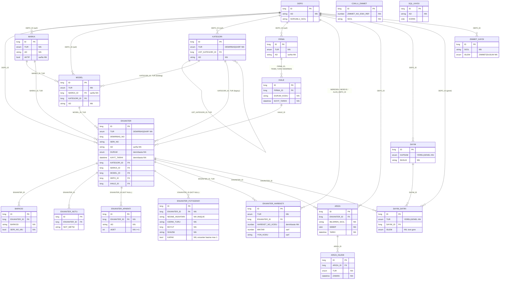

# HANDOFF — `depo-domain` modülü ve yeni şema

Bu doküman, `depo-domain` modülünü kullanacak **ayrı bir CRUD backend projesine** geçecek
geliştirici (ya da yeni bir Claude oturumu) için yazıldı. Önceki çalışmanın sohbet geçmişi
erişilebilir değildir; bu doküman tek başına yeterli olacak şekilde hazırlandı.

- Repo: `https://github.com/acartunahan/kaju-migration` (özel, branch `main`)
- Ayrıntılı tasarım: [asama2_domain_tasarim.md](asama2_domain_tasarim.md) (kararlar K1–K10, tablo/kolon eşlemesi)
- Legacy analizi ve açık sorular: [asama1_legacy_analiz.md](asama1_legacy_analiz.md) (S1–S30, Ç1–Ç13)
- Migration ve test notları: [asama4_migration_notlari.md](asama4_migration_notlari.md), [asama5_test_notlari.md](asama5_test_notlari.md)
- Gerçek kaynak (tek doğru): `depo-modernizasyon/depo-domain/src/main/resources/db/migration/domain/V1__domain_semasi.sql`
  ve `depo-modernizasyon/depo-domain/src/main/java/tr/depo/domain/**`. Doküman ile kod çelişirse **kod geçerlidir**.

---

## 0. Bağlam: neyi devralıyorsun

### 0.1 Proje ne yapıyor

2007 döneminden kalma bir Delphi masaüstü uygulaması (Oracle, legacy şema `DEPO`, 27 tablo:
`R_*`, `RESAT_*`, `SARF_*`) yeniden yazılıyor. Bu repo iki modül içerir:

| Modül | İçerik | Backend'de kullanılır mı |
|---|---|---|
| `depo-domain` | JPA entity'leri + hedef şemanın Flyway script'i (`V1__domain_semasi.sql`) | **Evet**, bağımlılık olarak |
| `depo-migration` | Spring Batch ile legacy `DEPO` → hedef şema tek seferlik göç | Hayır (ayrı uygulama). Sadece kurduğu `MIG_*` tabloları aynı şemada durur |

Kurumsal kısıt: Geliştirme kapalı ağ dışında yapılıyor. Kurumdaki gerçek veritabanına buradan
erişim yok ve kullanıcı iş yerinden yeni bilgi (profilleme sonucu, ham kayıt) **getiremiyor**.
Tasarım bu yüzden belirsizliğe dayanıklı kuruldu (bkz. bölüm 3, K1–K10). Gerçek veride göçün
KURU modda çalıştırılması kullanıcının iş yerinde yapacağı bir adım; sonucu bu projeye geri
gelmeyebilir.

### 0.2 Teknoloji ve doğrulanmış sürümler

Bu sürümler gerçek jar'lara karşı derlenip testleri koşturularak doğrulandı (uydurma değil):

| Bileşen | Sürüm |
|---|---|
| Java | 25 (Temurin 25.0.5) |
| Spring Boot | 4.0.9 (parent) |
| Hibernate ORM | 7.2.25 |
| Spring Batch | 6.0.6 (sadece migration) |
| Flyway | 11.14.1 |
| Oracle JDBC | ojdbc11 23.9 |
| Testcontainers | 2.0.5 (`testcontainers-oracle-free`), imaj `gvenzl/oracle-free:23-slim-faststart` |
| Maven | 3.9.x |

Maven koordinatları: `groupId = tr.depo`, `artifactId = depo-domain`, `version = 0.2.1`
(GitHub Packages: `https://maven.pkg.github.com/acartunahan/kaju-migration`; `domain-v<sürüm>` etiketiyle
`.github/workflows/domain-yayinla.yml` yayımlar. Yerelde: `mvn -B -pl depo-domain -am install`)
(parent: `depo-modernizasyon`). `depo-domain` bağımlılıkları: `hibernate-core`, `spring-data-jpa`
(audit anotasyonları için); test için JUnit 5 + AssertJ.

### 0.3 Mevcut durum (2026-11-08)

- Hedef şema **20 tablo**: Flyway `V1` (19 tablo) + `V2` (`ZIMMET_GECMISI`, 2026-11-08). **V1 ve V2 bundan
  sonra asla değiştirilmez**; yeni değişiklik `V3`, `V4`… olarak eklenir.
- Testler: 52 domain birim testi, 24 migration birim testi, 13 uçtan uca senaryo (gerçek Oracle,
  Testcontainers). GitHub Actions CI her push'ta `mvn verify` çalıştırır ve yeşil.
- Tüm tablolarda soft delete; fiziksel silme yasak (bkz. 3.4).
- Göç, gerçekçi mock legacy veriyle (27 tablo, 1.741 satır) yerelde çalıştırıldı: tüm tablolarda
  mutabakat tamam, alan mutabakatı 95 kontrol / 0 hata, legacy'ye yazma yok.
- Gerçek veriyle **hiç** çalıştırılmadı.

---

## 1. Aggregate root'lar ve aggregate sınırları

### 1.1 Önemli ön bilgi: entity'lerde koleksiyon yok

Domain modülünde **hiçbir entity'de `@OneToMany` koleksiyonu yoktur**. Tüm ilişkiler çocuktan
ebeveyne tek yönlü `@ManyToOne(fetch = LAZY)` olarak modellendi. Bunun nedenleri:

1. Migration yüz binlerce satırı chunk'lar halinde yazar; koleksiyonlar gereksiz yükleme ve
   dirty-checking maliyeti getirirdi.
2. Legacy'de FK yoktu; çocuk satırların ebeveyni bulunamayabilir (FK kolonu NULL kalır). Koleksiyon
   bu satırları zaten gösteremezdi.
3. Bir envanterin hareket geçmişi sınırsız büyüyebilir; koleksiyon olarak yüklenmesi yanlış olurdu.

Bu yüzden aggregate sınırları **JPA eşlemesiyle değil, uygulama servis ve repository katmanında**
uygulanmalıdır. Aşağıdaki tablo bu backend için önerilen sınırlardır (domain modülü bunları kodla
zorlamaz; ilişkiler ve kısıtlar veritabanında ve entity setter'larında korunur).

Bir çocuğun listesi her zaman sorguyla okunur, ör.
`SELECT f FROM EnvanterFotografi f WHERE f.envanter.id = :id ORDER BY f.sira`.

### 1.2 Önerilen aggregate'ler

| Aggregate (root) | İçindeki entity'ler | Root'a referansla bağlananlar (ayrı aggregate) | Not |
|---|---|---|---|
| **Depo** | — | Hemen her şey `DEPO_ID` ile bağlanır | Fiziksel depo / birim. Bağımsız tanım |
| **Kategori** | — (kendi kendine ağaç: `UST_KATEGORI_ID`) | Model, Envanter | Her düğüm bir root; ağaç işlemleri (taşıma, döngü kontrolü) servis işi |
| **Marka** | — | Model, Envanter | |
| **Model** | — | Envanter | Marka ve Kategori'ye ID referansı |
| **Firma** | — | Ihale | |
| **Ihale** | `IhaleKomisyonu` (embeddable) | Envanter | Sadece DEMIRBAS türü firmaya bağlanır |
| **Envanter** | `Barkod`, `EnvanterNotu`, `EnvanterAparati`, `EnvanterFotografi`, `GarantiSuresi` (embeddable), `Sicil` (embeddable) | EnvanterHareketi, Ariza, SayimSatiri | Ana iş nesnesi. Çocukların yaşam döngüsü envantere bağlı |
| **EnvanterHareketi** | — | — | **Ayrı aggregate**: yalnızca eklenen (append-only) geçmiş kaydı, hacmi büyük. Envantere ID ile bağlı |
| **Ariza** | `ArizaIslemi` | — | Arıza kaydı ve onun işlem geçmişi |
| **Sayim** | `SayimSatiri` | — | Sayım başlığı ve satırları |
| **ZimmetKaydi** | — | — | Sarf zimmet/düşüm günlüğü (append-only) |
| **CokluZimmet** | — | — | Anlamı doğrulanmamış legacy tablosu (S12); bağımsız |
| **SqlKaydi** | — | — | Legacy `R_SQL_KAYIT`; ne olduğu kesin değil (S30) |

### 1.3 Sınır kuralları (backend'de uygulanacak)

- **Repository'ler root'lar için açılır.** Çocuk entity'ler (Barkod, EnvanterNotu, EnvanterAparati,
  EnvanterFotografi, ArizaIslemi, SayimSatiri) için repository açmak serbesttir ama yazma işlemleri
  root'un uygulama servisi üzerinden yapılmalıdır (ör. `EnvanterServisi.fotografEkle(envanterId, …)`).
- **Aggregate'ler arası referans ID ile.** Entity'lerde zaten `@ManyToOne LAZY` var; servis katmanında
  başka bir aggregate'i değiştirmek için onun servisini çağırın. Bir işlemde (transaction) tek
  aggregate değiştirmek hedeflenmeli; istisna: kapak fotoğrafı değişimi gibi aynı aggregate içindeki
  çoklu satır güncellemeleri.
- **Silme her zaman soft delete** (bkz. 3.4). Root silindiğinde aggregate içindeki aktif çocuklar aynı
  transaction'da servis tarafından `sil()` ile işaretlenir; fiziksel silme hiçbir katmanda mümkün değildir.
- **EnvanterHareketi değiştirilmez.** Geçmiş kaydıdır; düzeltme yeni bir hareket olarak eklenmeli
  (öneri; kullanıcıyla doğrulanmadı).

---

## 2. Yeni şemanın Mermaid ER diyagramı

Sadece FK olarak kurulan ilişkiler çizildi. `TUR` ile işaretli ilişkiler bileşik FK'dir:
çocuk ve ebeveyn aynı türde olmak zorundadır (DEMIRBAS↔DEMIRBAS, SARF↔SARF). `_ESKI_REF`
kolonları FK değildir, diyagramda yoktur. Göç tabloları (`MIG_*`) ve Spring Batch tabloları
(`BATCH_*`) domain'e ait değildir, diyagramda yoktur.
Tüm domain tablolarında ortak kolonlar diyagramda gösterilmedi: audit (`VERSIYON`, `OLUSTURMA_ZAMANI`, `OLUSTURAN`,
`GUNCELLEME_ZAMANI`, `GUNCELLEYEN`) ve soft delete (`SILINME_ZAMANI`, `SILEN`).



### 2.1 Tablo listesi (20)

| # | Tablo | Entity | Legacy kaynağı |
|---|---|---|---|
| 1 | DEPO | `tanim.Depo` | RESAT_DEPO |
| 2 | KATEGORI | `tanim.Kategori` | RESAT_SABIT_KOD (DEMIRBAS) + SARF_KATEGORI (SARF) |
| 3 | MARKA | `tanim.Marka` | RESAT_MARKA (DEMIRBAS) + SARF_MARKA (SARF) |
| 4 | MODEL | `tanim.Model` | RESAT_MODEL (DEMIRBAS) + SARF_MODEL (SARF) |
| 5 | FIRMA | `tanim.Firma` | RESAT_FIRMA (DEMIRBAS) + SARF_FIRMA (SARF) |
| 6 | IHALE | `tanim.Ihale` | RESAT_IHALE |
| 7 | ENVANTER | `envanter.Envanter` | R_DEMIRBAS (DEMIRBAS) + R_TUKETIMCINSLERI (SARF) |
| 8 | BARKOD | `envanter.Barkod` | R_BARKOD |
| 9 | ENVANTER_NOTU | `envanter.EnvanterNotu` | R_DEMIRBAS_ACIKLAMA |
| 10 | ENVANTER_HAREKETI | `envanter.EnvanterHareketi` | R_HAREKET (DEMIRBAS) + R_SARFDEMIRBAS (SARF) |
| 11 | ENVANTER_APARATI | `envanter.EnvanterAparati` | Yok (yeni). Legacy R_APARAT bilinçli olarak taşınmaz |
| 12 | ENVANTER_FOTOGRAFI | `envanter.EnvanterFotografi` | Yok (yeni) |
| 13 | COKLU_ZIMMET | `envanter.CokluZimmet` | R_COKZIMMET |
| 14 | ARIZA | `ariza.Ariza` | R_ARIZA |
| 15 | ARIZA_ISLEMI | `ariza.ArizaIslemi` | R_ARIZA_LOG |
| 16 | SAYIM | `sayim.Sayim` | R_SAYIM |
| 17 | SAYIM_SATIRI | `sayim.SayimSatiri` | R_SAYIM_YEREL (YEREL) + R_SAYIM_GENEL (GENEL) |
| 18 | ZIMMET_KAYDI | `envanter.ZimmetKaydi` | SARF_LOG |
| 19 | SQL_KAYDI | `sistem.SqlKaydi` | R_SQL_KAYIT |
| 20 | ZIMMET_GECMISI | `envanter.ZimmetGecmisi` | Yok (yeni, V2). Migration başlangıç kaydını ENVANTER.ZIMMETLI_SICIL'den türetir |

Hedef tablosu olmayan legacy tablolar: `R_IADE_HAVUZU` ve `R_ARIZA_DEGERLENDIRME` **yalnızca
arşivlenir** (ham JSON olarak `MIG_HAM_VERI`'de, `HEDEF_TABLO = 'ARSIV'`); `R_APARAT` **taşınmaz ve
arşivlenmez** (her göç raporunda satır sayısıyla `KAPSAM_DISI_KARAR` uyarısı olarak görünür).

---

## 3. Alınan önemli tasarım kararları ve gerekçeleri

### 3.1 Belirsizlik altında tasarım kuralları (K1–K10, özet)

| # | Kural | Gerekçe ve backend'e etkisi |
|---|---|---|
| K1 | Her legacy satırının tamamı ham JSON olarak `MIG_HAM_VERI`'de saklanır | Veri sessizce kaybolmaz; yanlış eşlenen alan sonradan ham veriden düzeltilebilir. Backend bu tabloya yazmaz |
| K2 | İlişkiler kanıt düzeyine göre: KESİN/GÜÇLÜ → NULL olabilen FK; ZAYIF → FK yok, ham değer `*_ESKI_REF` kolonunda | Legacy'de FK yoktu, kopuk referanslar olabilir. **Bu yüzden çoğu FK kolonu NULL olabilir** (bkz. bölüm 6) |
| K3 | Kod kolonları: anlamı kesin olanlar enum; anlamı bilinmeyenler ham kod (`*_KODU`) | Uydurma anlam yüklenmedi. Tanınmayan kod gelirse göç o satırı reddeder (RED) |
| K4 | Yeni sayısal ID (sequence); legacy GUID/ID domain tablolarında tutulmaz, `MIG_KIMLIK_ESLEME`'de | Bkz. 3.3 |
| K5 | Metin kolonları CHAR semantiğinde, legacy uzunluğu kadar ya da daha geniş; DB karakter seti AL32UTF8 | Legacy'de BYTE/CHAR semantiği bilinmiyor (#8); geniş tutmak kayıpsız |
| K6 | Tarihler `LocalDateTime` / `TIMESTAMP(0)` (legacy DATE), audit alanları UTC `TIMESTAMP(6)` | Bkz. 3.6 |
| K7 | Personel tablosu yok; sicil `Sicil` değer nesnesi | Legacy'de personel tablosu yok (S2) |
| K8 | Belirsiz **veri** birleştirmeleri yapılmaz; **tablo** birleştirmeleri (TUR ile) yapıldı | Bkz. 3.2 |
| K9 | Kapsam: 24 tablo taşınır, 2 arşivlenir, 1 taşınmaz | Bkz. 2.1 |
| K10 | Profillemenin yerini KURU çalıştırma alır | Gerçek veride önce KURU mod rapor üretir |

### 3.2 Birleştirilen ve bölünen tablolar

Legacy'de 27 tablo vardı; hedefte 19 tablo var. Hepsi **tablo birleştirmesidir, veri birleştirmesi
değildir**: her legacy satırı tek bir hedef satıra gider; aynı ad iki tarafta da varsa iki satır olur.

| Karar (tarih) | Ne yapıldı | Gerekçe |
|---|---|---|
| Marka/model/firma (2026-11-07) | `RESAT_MARKA`+`SARF_MARKA` → `MARKA`; `RESAT_MODEL`+`SARF_MODEL` → `MODEL`; `RESAT_FIRMA`+`SARF_FIRMA` → `FIRMA`. `TUR` (`MalzemeTuru`: DEMIRBAS/SARF) ayırır | Kullanıcı isteği; aynı yapıdaki tablolar. Türler arası yanlış bağlantı bileşik FK ile engellenir |
| Kategori (2026-11-07) | `RESAT_SABIT_KOD` (eski uygulamanın kategori ağacı, kullanıcı teyidi) + `SARF_KATEGORI` → tek `KATEGORI` ağacı (`TUR`; üst kayıt aynı türde) | Yeni uygulamada kategori sahibinden.com tarzı katalog ağacıdır |
| Katalog bağlantısı (2026-11-07) | `MODEL.KATEGORI_ID` eklendi; migration'da türetilir (bkz. 6.5). Legacy değer `ENVANTER.KATEGORI_ID`'de de korunur | Legacy'de kategori modelde değil demirbaşın satırındaydı |
| Envanter (2026-11-08) | `R_DEMIRBAS` + `R_TUKETIMCINSLERI` → tek `ENVANTER` (`TUR`). Her tüketim cinsi (Toner, A4 kağıt…) bir sarf malzemesidir | Kullanıcı isteği: ayrı bir "sarf" entity'si olmasın |
| Hareket (2026-11-08) | `R_HAREKET` + `R_SARFDEMIRBAS` → tek `ENVANTER_HAREKETI` (`TUR`). `R_SARFDEMIRBAS.ADI` = sarf envanterin legacy GUID'i | Envanterle aynı mantık |
| Zimmet günlüğü (2026-11-08) | `SARF_LOG` → `ZIMMET_KAYDI` | İsimlendirme sadeleştirildi |
| Sayım (2026-11-08) | `R_SAYIM_YEREL` + `R_SAYIM_GENEL` → tek `SAYIM_SATIRI` (`TUR` = YEREL/GENEL). Yereldeki eski `TUR` (Z/S) kolonu `MALZEME_TURU` oldu | Kullanıcı isteği. ISLEM kod kümeleri farklı olduğu için kodlar birleştirilmedi (bkz. 3.5) |
| Aparat (2026-11-07) | Legacy `R_APARAT` taşınmaz; yeni `ENVANTER_APARATI` (envantere bağlı, çoklu) | Legacy aparat demirbaşa bağlı değildi (Ç13). Yeni ürünlerin aparatları bu tabloya girilir |
| Fotoğraf (2026-11-08) | Yeni `ENVANTER_FOTOGRAFI` (envantere bağlı, çoklu); dosya S3 uyumlu nesne deposunda | Ürün eklenirken fotoğraf isteniyor. Bkz. 5.12 |
| Arşiv (2026-11-07) | `R_IADE_HAVUZU`, `R_ARIZA_DEGERLENDIRME` sadece arşiv | Kapsam kararı |
| **Bilerek bölünmeyen** | `R_HAREKET` tek tablo kaldı (StokTakip reposundaki gibi depo/personel diye bölünmedi) | Bölme kuralı (Ç7) doğrulanamadı |

**Türler arası bütünlük nasıl korunuyor:**
- Ebeveyn tablolarda `UNIQUE (ID, TUR)` var (`UK_KATEGORI_ID_TUR`, `UK_MARKA_ID_TUR`, `UK_MODEL_ID_TUR`,
  `UK_FIRMA_ID_TUR`, `UK_ENVANTER_ID_TUR`).
- Çocuklar bileşik FK ile bağlanır: `MODEL(MARKA_ID, TUR) → MARKA(ID, TUR)`,
  `MODEL(KATEGORI_ID, TUR) → KATEGORI(ID, TUR)`, `KATEGORI(UST_KATEGORI_ID, TUR) → KATEGORI(ID, TUR)`,
  `ENVANTER(KATEGORI_ID|MARKA_ID|MODEL_ID, TUR) → …(ID, TUR)`, `ENVANTER_HAREKETI(ENVANTER_ID, TUR) → ENVANTER(ID, TUR)`.
- `IHALE` tarafında sabit `'DEMIRBAS'` değerli sanal kolon (`TANIM_TURU VARCHAR2(10) GENERATED ALWAYS AS ('DEMIRBAS') VIRTUAL`)
  ile `FK_IHALE_FIRMA (FIRMA_ID, TANIM_TURU) → FIRMA(ID, TUR)`. Entity'de bu kolon eşlenmez.
- Entity tarafında: `MalzemeTuru.tanimDogrula(beklenen, x)` setter'larda çağrılır. **Yüklenmemiş LAZY
  proxy'lerde kontrol atlanır** (`Hibernate.isInitialized` false ise sorgu tetiklenmez); o durumda
  kuralı veritabanındaki bileşik FK zorlar. Yani bir `getReference()` proxy'si atanırsa hata
  commit/flush anında `ORA-02291` olarak gelir.
- Türe özgü zorunluluklar CHECK ile (bkz. bölüm 5).
- `TUR` kolonları `updatable = false`: bir kaydın türü sonradan değiştirilemez.

**Bilinen ödünleşim:** `ENVANTER` ve `ENVANTER_HAREKETI`'nde her satırın yaklaşık yarısı boştur
(diğer türe özgü kolonlar). Java'da tek sınıf olduğu için yanlış türde alan set etmek derlenir
(ör. sarf envantere `setDemirbasNo`); bazı kurallar çalışma anında setter'larda kontrol edilir.
JPA `SINGLE_TABLE` kalıtımına (Demirbas/Sarf alt sınıfları; tablo aynı kalır) geçiş önerildi,
kullanıcı **"şimdilik kalsın"** dedi (bkz. bölüm 7).

### 3.3 ID stratejisi ve legacy kimlikleri

- Her tablonun kendi sequence'i: `<TABLO>_SEQ`, `START WITH 1 INCREMENT BY 50`.
- Entity'de: `@GeneratedValue(strategy = SEQUENCE, generator = "...")` + `@SequenceGenerator(sequenceName = "<TABLO>_SEQ", allocationSize = 50)`.
  Sequence adı her entity'de açıkça yazılır; Hibernate'in örtük adlandırmasına güvenilmez.
  **`allocationSize` ile `INCREMENT BY` her zaman eşit olmalı** (50); farklıysa Hibernate çakışan ID üretir.
- ID tipi `Long` (`NUMBER(19)`). ID alanı `BaseEntity`'de değil, her entity'de tanımlıdır.
- **Legacy GUID/ID domain tablolarında yok.** Eşleme `MIG_KIMLIK_ESLEME` tablosunda:
  `KAYNAK_TABLO`, `KAYNAK_ROWID`, `ESKI_ID`, `ESKI_ANAHTAR_HAM` (legacy değer olduğu gibi),
  `ESKI_ANAHTAR_NORM` (normalize: süslü parantez silinir, trim, büyük harf), `HEDEF_TABLO`, `HEDEF_ID`, `KURU`.
  Gerçek göç satırları `KURU = 0`. Örnek: bir envanterin legacy GUID'i:
  `SELECT ESKI_ANAHTAR_HAM FROM MIG_KIMLIK_ESLEME WHERE KURU = 0 AND HEDEF_TABLO = 'ENVANTER' AND KAYNAK_TABLO = 'R_DEMIRBAS' AND HEDEF_ID = :id`.
  Not: `ENVANTER` iki legacy tablodan beslenir; `KAYNAK_TABLO` ile ayırın (`R_DEMIRBAS` / `R_TUKETIMCINSLERI`).
  Aynı şekilde `ENVANTER_HAREKETI` (`R_HAREKET` / `R_SARFDEMIRBAS`) ve `SAYIM_SATIRI` (`R_SAYIM_YEREL` / `R_SAYIM_GENEL`).
- Göçle gelen satırlar: `OLUSTURAN = 'MIGRATION'`. Yeni kayıtlarda kullanıcının sicili/adı olur.
- Backend için öneri: legacy kimliğine kullanıcı arayüzünde ihtiyaç varsa (ör. eski demirbaş GUID'iyle
  arama) salt okunur bir sorgu/view ile `MIG_KIMLIK_ESLEME`'ye bakın; domain tablolarına legacy kolon
  eklemeyin. `MIG_*` tablolarına **yazmayın**.

### 3.4 Soft delete — fiziksel silme YOK (karar 2026-11-08)

Kullanıcı kararı: **her tabloda soft delete, asla hard delete.** (Bu karar S14 sorusunu kapatır.)

**Şema:** 20 domain tablosunun hepsinde:
- `SILINME_ZAMANI TIMESTAMP(6)` (UTC duvar saati; NULL = silinmemiş) ve `SILEN VARCHAR2(36 CHAR)`.
- `CK_<TABLO>_SILME`: ikisi birlikte dolu ya da birlikte boş.
- `TRG_<TABLO>_SILME_YASAK`: statement seviyesinde `BEFORE DELETE` trigger'ı; satır etkilenmese bile her
  `DELETE` ifadesini `ORA-20001` ile reddeder (native SQL ve elle yapılan silmeler dahil). `TRUNCATE`/`DROP`
  DDL'dir, trigger yakalamaz; bunlar yetkiyle engellenmeli (uygulama kullanıcısına verilmez).
- Bu yüzden şema kurulumu için hedef kullanıcıda **`CREATE TRIGGER` yetkisi** gerekir
  (test ortamı, yerel DB ve DBA runbook'u buna göre güncellendi).
- `MIG_*` göç tablolarında soft delete ve trigger yok (domain değiller).

**Entity (`BaseEntity`, tüm entity'ler miras alır):**
- `sil(String silen)` — UTC şimdiki zamanla işaretler; `sil(String silen, LocalDateTime zaman)` — zaman dışarıdan.
  `silen` zorunlu, trim edilir, en fazla 36 karakter. Zaten silinmişse `IllegalStateException`.
- `geriAl()` — işareti kaldırır; silinmemişse `IllegalStateException`.
- `isSilindi()`, `getSilinmeZamani()`, `getSilen()`.
- Silme/geri alma bir **güncellemedir**: `VERSIYON` artar, `GUNCELLEME_ZAMANI`/`GUNCELLEYEN` dolar (optimistic lock geçerli).
- `@PreRemove fizikselSilmeYasak()`: `EntityManager.remove()` ve Spring Data `delete*()` çağrıları veritabanına
  gitmeden `UnsupportedOperationException` ile reddedilir.
- `silinmemisOlmali(hedef, alan)`: tüm ilişki setter'larında (ve aparat/fotoğraf kurucularında) çağrılır;
  **silinmiş bir kayda yeni bağlantı kurulamaz** (`IllegalArgumentException`). Yüklenmemiş LAZY proxy'de kontrol
  atlanır. Var olan bağlantılar korunur (silinmiş markaya bağlı eski envanterler bozulmaz).

**Görünürlük (Hibernate filtresi):**
- `BaseEntity` üzerinde `@FilterDef(name = "silinmemis", defaultCondition = "SILINME_ZAMANI IS NULL",
  autoEnabled = true, applyToLoadByKey = false)` + `@Filter`. Sabit: `BaseEntity.SILINMEMIS_FILTRESI`.
- **Otomatik açık:** tüm HQL/JPQL/Criteria sorguları (Spring Data repository metotları dahil) silinmiş kayıtları getirmez.
- **ID ile yüklemeye uygulanmaz:** `find()`, `getReference()` ve LAZY `@ManyToOne` silinmiş kaydı yine yükler.
  Böylece silinmiş bir envanterin hareket geçmişi, silinmiş markaya bağlı envanterler vb. çalışmaya devam eder.
- Silinmişler dahil liste (çöp kutusu / denetim ekranı): oturumda filtreyi kapatın:
  `entityManager.unwrap(Session.class).disableFilter(BaseEntity.SILINMEMIS_FILTRESI)`.
- **Native SQL filtrelenmez**: native sorgularda `SILINME_ZAMANI IS NULL` koşulunu elle yazın
  (migration'daki `ModelKategorisiTuretici` buna göre güncellendi).
- Gerçek Oracle'da uçtan uca test edildi (senaryo 12): filtre, ID ile yükleme, `remove()` reddi, trigger reddi,
  CHECK, kapak index'i ve geri alma.

**Tekil kısıtlar ve soft delete:** Silinmiş satırlar tekil kısıtlarda yer kaplamaya devam eder. Bu yüzden:
- `UX_ENVANTER_FOTOGRAFI_KAPAK` silinmiş fotoğrafları saymaz (`CASE WHEN KAPAK = 1 AND SILINME_ZAMANI IS NULL ...`).
- `UK_ENVANTER_FOTOGRAFI_NESNE` silinmiş satırları da kapsar (nesne anahtarı her yüklemede yeni üretildiği için sorun değil).
- Gelecekte bir iş kolonuna tekil kısıt eklenirse aynı desen kullanılmalı: fonksiyon tabanlı tekil index,
  `CASE WHEN SILINME_ZAMANI IS NULL THEN <KOLON> END`.

**Index:** `SILINME_ZAMANI` index'lenmedi (satırların büyük çoğunluğu NULL; Oracle B-tree tamamen NULL anahtarları
tutmaz, `IS NULL` filtresine faydası olmaz). Silinmiş kayıt oranı büyürse yeniden değerlendirin.

**Aggregate içinde silme (servis sorumluluğu):** Koleksiyon olmadığı için `Envanter.sil()` çocukları otomatik
silmez. Önerilen kural: `EnvanterServisi.sil()` aynı transaction'da envanterin aktif barkod, not, aparat ve
fotoğraflarını da `sil()` ile işaretler; hareketler (geçmiş) ve arızalar silinmez. Benzer şekilde `Ariza` →
`ArizaIslemi`, `Sayim` → `SayimSatiri`. Tanım kayıtları (marka, model, kategori, depo, firma, ihale) silinince
onlara bağlı eski kayıtlar korunur; yalnızca yeni bağlantı kurulamaz. Kategori silinirken alt kategorileri ne olacak
(birlikte silinsin mi, engellensin mi) backend'de kararlaştırılmalı.

**Silinmiş kaydın düzenlenmesi:** Entity bunu engellemez. Önerilen: servis katmanında silinmiş kayıt üzerinde
`geriAl()` dışında güncelleme reddedilir.

`MARKA.AKTIF` ve `MODEL.AKTIF` soft delete değildir; legacy sarf tablolarından gelen iş alanlarıdır.

### 3.5 Enum ve converter kararları

- Tüm enum'lar **`@Enumerated(EnumType.STRING)`**; kolon `VARCHAR2(10–30 CHAR)`, değerler CHECK ile
  sınırlı. `ORDINAL` kullanılmaz.
- Enum değerleri İngilizce/ASCII büyük harf Türkçe sözcüklerdir (`DUZELTME`, `ARIZALI`); Türkçe karakter yok.
- Legacy kod → enum eşlemesi **domain'de değil**, migration `application.yml` (`migration.kod-esleme.*`)
  içinde. Backend legacy kodlarla ilgilenmez.

| Enum | Paket | Değerler | Kaynak (KESİN = DDL comment'i) | Kolon |
|---|---|---|---|---|
| `MalzemeTuru` | tanim | DEMIRBAS, SARF | Tasarım | KATEGORI/MARKA/MODEL/FIRMA/ENVANTER/ENVANTER_HAREKETI.TUR |
| `AlimYolu` | envanter | BILGI_ISLEM_DB, IKMAL_BAKIM_DB, HABERLESME_DB, HABERALMA_OD, KAYNAGI_BELIRSIZ | R_DEMIRBAS.ALIM_YOLU (0–4) | ENVANTER.ALIM_YOLU |
| `DemirbasDurumu` | envanter | NORMAL, ARIZALI | R_DEMIRBAS.DURUM "1-Normal, 2-Arıza" | ENVANTER.DURUM |
| `ZimmetIslemi` | envanter | ZIMMET, DUSUM | SARF_LOG.ISLEM | ZIMMET_KAYDI.ISLEM |
| `ArizaIslemTuru` | ariza | ISLEM, BILGI, SIKAYET, TESEKKUR | R_ARIZA_LOG.TUR (1–4) | ARIZA_ISLEMI.TUR |
| `SayimKapsami` | sayim | YEREL, GENEL | R_SAYIM.TUR "Y/G" | SAYIM.KAPSAM ve SAYIM_SATIRI.TUR |
| `SayimDurumu` | sayim | DEVAM_EDIYOR, TAMAMLANDI | R_SAYIM.DURUM "0/1" | SAYIM.DURUM |
| `SayimIslemi` | sayim | SAYILMADI, SAYILDI, ZIMMET_DUZELTME, REZERVE, DUZELTME | R_SAYIM_YEREL.ISLEM (0–3) + R_SAYIM_GENEL.ISLEM (0–2) | SAYIM_SATIRI.ISLEM |
| `YerelSayimTuru` | sayim | ZIMMET, SARF | R_SAYIM_YEREL.TUR "Z/S" | SAYIM_SATIRI.MALZEME_TURU |

`SayimIslemi` özel durumu: legacy'de '2' yerelde "Zimmet Düzeltme", genelde "Düzeltme" demektir.
Kodlar birleştirilmedi; enum iki kümenin birleşimi ve her değer hangi türde geçerli olduğunu bilir:
`SayimIslemi.gecerliMi(SayimKapsami)`. YEREL: SAYILMADI, SAYILDI, ZIMMET_DUZELTME, REZERVE.
GENEL: SAYILMADI, SAYILDI, DUZELTME. DB: `CK_SAYIM_SATIRI_ISLEM`.

**Converter:** `ortak.BooleanSayiConverter` — `Boolean ↔ NUMBER(1)` (1/0). Neden: Hibernate'in Oracle
dialect'i boolean'ı Oracle 23ai'de yerel `BOOLEAN`'a, öncekilerde `NUMBER(1)`'e eşler; testler 23ai,
üretimin sürümü bilinmiyor. Converter iki ortamda aynı kolon tipini garanti eder. `autoApply` yok;
her boolean alanda açıkça `@Convert(converter = BooleanSayiConverter.class)` yazılır. Kullanıldığı
yerler: `Barkod.seriNoMu`, `Marka.aktif`, `Model.aktif`, `EnvanterFotografi.kapak`.
**Yeni boolean alan eklerken bu converter'ı kullanın** ve kolonu `NUMBER(1)` + `CHECK (X IN (0, 1))` yapın.

**Ham kod kolonları (enum değil, anlamı bilinmiyor):** `*_DURUM_KODU` (VARCHAR2(1)), `ENVANTER.ALIM_TURU_KODU`,
`ENVANTER.BIRIM_KODU` / `IHALE.BIRIM_KODU` (NUMBER), `ARIZA.ASAMA_KODU`, `ARIZA_ISLEMI.ISLEM_KODU`,
`ENVANTER_HAREKETI.HAREKET_NO_KODU` ve `YON_KODU`, `IHALE.YERINDE_GARANTI_KODU`, `IHALE.ONARIM_SURESI_KODU`.
Bunlara backend'de anlam yüklemeyin; anlamı netleşince enum'a çevirmek için Flyway script'i + veri
dönüşümü gerekir.

### 3.6 Zaman ve audit

- `BaseEntity` (`@MappedSuperclass`, `@EntityListeners(AuditingEntityListener.class)`):
  `VERSIYON` (`@Version int`, optimistic locking), `OLUSTURMA_ZAMANI` + `OLUSTURAN` (insert'te dolar,
  `updatable = false`), `GUNCELLEME_ZAMANI` + `GUNCELLEYEN`.
- Audit zamanları **UTC duvar saatidir**: `LocalDateTime`, `TIMESTAMP(6)`, saat dilimi bilgisi yok.
  `Instant` + `TIMESTAMP WITH TIME ZONE` kullanılmadı: Hibernate 7.2 `Instant`'ı TIMESTAMP_UTC (3003)
  koduyla eşliyor, Oracle sürücüsü bu kolonu -101 koduyla bildiriyor ve `ddl-auto=validate`
  "wrong column type" ile başlamıyor (doğrulanmış).
- İş tarihleri (`KAYIT_TARIHI`, `TARIH`, garanti vb.) `LocalDateTime` + `TIMESTAMP(0)` (legacy DATE
  saniye hassasiyeti). Saat dilimi dönüşümü yapılmaz.
- **Backend'in sağlaması gerekenler:**
  - `@EnableJpaAuditing(auditorAwareRef = "...", dateTimeProviderRef = "...")`
  - `AuditorAware<String>`: oturumdaki kullanıcının sicili/kimliği (en fazla 36 karakter). Migration `"MIGRATION"` döndürür.
  - `DateTimeProvider`: `() -> Optional.of(LocalDateTime.now(ZoneOffset.UTC))`.
  - Arayüzde gösterirken UTC → yerel saat (Europe/Istanbul) dönüşümü backend/frontend işidir.

### 3.7 Embeddable'lar (değer nesneleri)

Hepsi Java `record` + `@Embeddable`. Kolon adları kullanıldığı yerde `@AttributeOverride` ile verilir.

| Embeddable | Alanlar | Kurallar | Kullanıldığı yerler |
|---|---|---|---|
| `ortak.Sicil` | `deger` | Kurucuda: null olamaz, `strip()` edilir, boş olamaz. Baştaki sıfır eklenmez/silinmez (S3: biçim bilinmiyor). `Sicil.varsa(String)` null/boş için null döner | Depo.sorumluSicil (SORUMLU_SICIL 10), Envanter.zimmetliSicil (ZIMMETLI_SICIL 7), EnvanterNotu.ekleyenSicil (7), EnvanterHareketi.islemYapanSicil (6), CokluZimmet.sicil (SICIL 40, NN), ZimmetKaydi.sicil (7, NN) ve islemYapanSicil (36), Ariza.bildirenSicil (36, NN), ArizaIslemi.islemYapanSicil ve gorevliSicil (36, NN), SqlKaydi.kullaniciSicil (10) |
| `ortak.IletisimKisisi` | `ad`, `telefon` | Doğrulama yok (legacy'de ikisi de boş olabilir) | Firma.yetkili (YETKILI_AD 255, YETKILI_TELEFON 50), Firma.irtibat (IRTIBAT_AD 255, IRTIBAT_TELEFON 255) |
| `envanter.GarantiSuresi` | `baslangic`, `bitis` | Bitiş ≥ başlangıç **zorlanmaz** (legacy'de ihlal olabilir); `gecerliMi()` ile sorgulanır. Yeni kayıtlarda servis doğrulamalı | Envanter.garanti (GARANTI_BASLANGIC, GARANTI_BITIS) |
| `tanim.IhaleKomisyonu` | `baskan`, `uye1`, `uye2` | Doğrulama yok; isim mi sicil mi belli değil (S29) | Ihale.komisyon (KOMISYON_BASKANI/UYE1/UYE2, 100) |
| `sayim.MalzemeAnlikGorunumu` | `ad`, `marka`, `model`, `seriNo` | Sayım anındaki metin kopyası; envanterden yeniden hesaplanmaz | SayimSatiri.anlikGorunum (ANLIK_AD 75, ANLIK_MARKA/MODEL/SERI_NO 50) |

Not: Embeddable'ın tüm alanları NULL ise Hibernate embeddable'ı `null` olarak yükler.

### 3.8 Diğer kalıcı kararlar

- **Şemayı sadece Flyway kurar**, Hibernate `ddl-auto=validate` ile doğrular. Entity değişikliği her zaman
  bir Flyway script'iyle birlikte yapılır.
- **Hibernate HTE_ tabloları kapalı:** `hibernate.query.mutation_strategy.global_temporary.create_tables=false`
  ve `drop_tables=false`. Aksi halde Hibernate Oracle'da açılışta her entity için `HTE_<TABLO>` global
  temporary table oluşturmaya çalışır. Entity'lerde kalıtım ve toplu HQL mutasyonu yok.
- `hibernate.type.java_time_use_direct_jdbc=true` (LocalDateTime doğrudan JDBC ile; JVM saat dilimi etkisi yok).
- `spring.jpa.open-in-view=false`.
- `equals`/`hashCode` `BaseEntity`'de `final`: aynı gerçek sınıf (proxy açılarak) + aynı null olmayan ID.
  `hashCode` sınıfa göre sabittir (ID kayıtta atandığı için). Entity'lerde equals/hashCode yazmayın.
- **Lombok yok** (özellikle `@Data` yasak: equals/hashCode ve lazy ilişkilerde `toString` sorunları).
  Getter/setter elle yazılır; setter'lar iş kuralı doğrular.
- `jakarta.*` paketleri (javax yok).
- Tüm `@ManyToOne` `fetch = LAZY`. EAGER yok.
- Her FK kolonunda index var (Oracle FK'ye otomatik index açmaz; yoksa ebeveyn silme/güncellemede tablo kilidi riski).
- `@Lob` CLOB kolonlar: `ARIZA.SEBEP`, `ARIZA_ISLEMI.ACIKLAMA`, `SQL_KAYDI.ICERIK`.

---

## 4. Naming convention'lar ve kod standartları

### 4.1 Dil

Kod, tablo, kolon, sınıf, metot, değişken, log ve hata mesajları **Türkçe** (ASCII'ye çevrilmiş
tanımlayıcılar: `Envanter`, `setKayitTarihi`, `ZIMMET_KAYDI`). Javadoc ve yorumlar Türkçe karakterli.
Framework kavramları İngilizce kalır (`Repository`, `Service` son ekleri backend'de serbest; domain'de
yok).

### 4.2 Veritabanı

| Öğe | Kural | Örnek |
|---|---|---|
| Tablo | BÜYÜK_HARF, tekil, Türkçe | `ENVANTER_HAREKETI` |
| Kolon | BÜYÜK_HARF | `KAYIT_TARIHI` |
| PK | Her tabloda `ID NUMBER(19)` | `PK_<TABLO>` |
| Sequence | `<TABLO>_SEQ`, INCREMENT BY 50 | `ENVANTER_SEQ` |
| FK kolonu | `<HEDEF>_ID` (rol varsa önek) | `ENVANTER_ID`, `NEREDEN_DEPO_ID`, `UST_KATEGORI_ID` |
| FK constraint | `FK_<TABLO>_<HEDEF/ROL>` | `FK_ENVANTER_MARKA`, `FK_ENV_HAREKETI_NEREYE_DEPO` |
| Unique | `UK_<TABLO>_<KOLON>`; fonksiyon tabanlı tekil index `UX_` | `UK_ENVANTER_FOTOGRAFI_NESNE`, `UX_ENVANTER_FOTOGRAFI_KAPAK` |
| Check | `CK_<TABLO>_<KONU>` | `CK_ENVANTER_DEMIRBAS` |
| Index | `IX_<TABLO>_<KOLON>` | `IX_ENVANTER_SERI_NO` |
| Ham legacy kod | `_KODU` son eki | `DURUM_KODU` |
| Çözülmemiş legacy referans | `_ESKI_REF` son eki (FK değil) | `MALZEME_ESKI_REF` |
| Serbest metin karşılığı | `_METNI` son eki | `NEREDEN_METNI` |
| Boolean | `NUMBER(1)` + `CHECK (X IN (0, 1))` | `KAPAK` |
| Metin | `VARCHAR2(n CHAR)` (CHAR semantiği) | |
| İş tarihi / audit | `TIMESTAMP(0)` / `TIMESTAMP(6)` | |
| Audit kolonları | Her tabloda: `VERSIYON`, `OLUSTURMA_ZAMANI`, `OLUSTURAN`, `GUNCELLEME_ZAMANI`, `GUNCELLEYEN` | |
| Soft delete kolonları | Her tabloda: `SILINME_ZAMANI TIMESTAMP(6)`, `SILEN VARCHAR2(36 CHAR)` + `CK_<TABLO>_SILME` | |
| Silme yasağı trigger'ı | `TRG_<TABLO>_SILME_YASAK` (BEFORE DELETE, ORA-20001) | `TRG_ENVANTER_SILME_YASAK` |
| Tür ayırıcı | `TUR` | |

Oracle constraint adları 128 karakteri aşmamalı; mevcut adlar kısa tutuldu (`ENV_HAREKETI` kısaltması gibi).

### 4.3 Flyway

- Domain script'leri: `depo-domain/src/main/resources/db/migration/domain/`, sürüm aralığı **V1–V999**.
- Migration (göç) script'leri: `depo-migration/.../db/migration/goc/`, **V1000+** (V1000 göç tabloları, V1001 Spring Batch şeması).
- İki akış aynı `flyway_schema_history`'yi paylaşır; bu yüzden `spring.flyway.out-of-order: true`.
- V1 canlıya kurulduktan sonra değiştirilmez. Yeni değişiklik: `V2__<aciklama>.sql`.
- Script'lerde tüm metin kolonları `CHAR` semantiği ile yazılır; FK'lerde CASCADE kullanılmaz; her FK kolonuna index.

### 4.4 Java

| Konu | Kural |
|---|---|
| Paket | `tr.depo.domain.<bağlam>`: `tanim`, `envanter`, `ariza`, `sayim`, `sistem`, `ortak` |
| Entity | `extends BaseEntity`; `@Table(name = "...")` açık; her `@Column` adı açık |
| Kurucular | JPA için `protected` boş kurucu. Zorunlu alanlar public kurucu ya da **statik fabrika** ile (ör. `Envanter.demirbas(durum, kayitTarihi)`, `Envanter.sarf(ad)`, `Kategori.demirbasKategorisi(ad, durumKodu)`, `Model.sarfModeli(marka, ad, aktif)`, `Firma.sarfFirmasi(ad)`, `SayimSatiri.yerel(...)`, `SayimSatiri.genel(...)`, `EnvanterHareketi.demirbasHareketi(hareketNo)`) |
| Setter | İş kuralını doğrular; zorunlu alanlarda `Objects.requireNonNull(x, "alanAdi")`, kural ihlalinde `IllegalArgumentException` |
| İlişki | `@ManyToOne(fetch = FetchType.LAZY)` + `@JoinColumn(name = "...")`; koleksiyon yok |
| Enum | `@Enumerated(EnumType.STRING)`, `length` kolonla aynı |
| Boolean | `@Convert(converter = BooleanSayiConverter.class)` |
| Değer nesnesi | `record` + `@Embeddable`, kolon adları `@AttributeOverride` ile |
| Tür alanı | `updatable = false` |
| Silme | Sadece `entity.sil(silen)`; `geriAl()` ile geri alınır. Yeni ilişki setter'larında `silinmemisOlmali(x, "x")` çağrılır. Yeni tabloda `SILINME_ZAMANI`/`SILEN` kolonları, `CK_<TABLO>_SILME` ve `TRG_<TABLO>_SILME_YASAK` eklenmeli (BaseEntity'den gelen alanlar `ddl-auto=validate` ile kontrol edilir) |
| Yasak | Lombok, `javax.*`, EAGER, `@Data`, entity'de equals/hashCode override, CascadeType.REMOVE, `em.remove()` / repository `delete*()` (çalışma anında reddedilir), DELETE içeren native SQL |
| Bilgi etiketleri | Javadoc'ta kanıt düzeyi: [KESİN] (DDL comment'i), [GÜÇLÜ TAHMİN], [ZAYIF TAHMİN]. ZAYIF olan hiçbir şey doğrulanmadan modele yansıtılmaz |
| Test | JUnit 5 + AssertJ. Birim test adları Türkçe snake_case (`bir_envanterin_birden_fazla_fotografi_olabilir`). Uçtan uca testler `*EntegrasyonTesti` (failsafe), gerçek Oracle (Testcontainers) |
| Gizli bilgi | Bağlantı bilgisi sadece ortam değişkeninden; repoda şifre yok. Yerel Docker şifreleri `yerel-db/.env` (git dışı) |

### 4.5 Backend için gerekli yapılandırma (domain modülünü kullanırken)

```yaml
spring:
  jpa:
    open-in-view: false
    hibernate:
      ddl-auto: validate
    properties:
      hibernate:
        type:
          java_time_use_direct_jdbc: true
        query:
          mutation_strategy:
            global_temporary:
              create_tables: false
              drop_tables: false
  flyway:
    locations: classpath:db/migration/domain
    out-of-order: true
```

- Entity tarama: Spring Boot uygulama paketi `tr.depo` altında değilse `@EntityScan("tr.depo.domain")`.
- **Flyway dikkat:** Göç uygulaması aynı şemada V1000/V1001'i de çalıştırmış olacak. Backend yalnızca
  `db/migration/domain` konumunu görürse Flyway "applied migration not resolved locally" hatası verir.
  Çözüm seçenekleri: `spring.flyway.ignore-migration-patterns: "*:missing"`; ya da backend'de Flyway'i
  kapatıp şema değişikliklerini tek bir yerden yönetmek. Bu karar backend'de verilmeli.
- `@EnableJpaAuditing` + `AuditorAware<String>` + UTC `DateTimeProvider` (bkz. 3.6).
- Veritabanı kullanıcısı: şema Flyway ile kurulacaksa `CREATE TRIGGER` yetkisi gerekir. Uygulamanın çalışma
  zamanı kullanıcısına DELETE/TRUNCATE yetkisi verilmemesi önerilir (fiziksel silme zaten trigger'la yasak).
- Spring Data: `JpaRepository.delete*()` metotları `@PreRemove` nedeniyle hata verir. Repository'lerde bunları
  kullanmayın; isterseniz silme metotlarını gizleyen bir temel repository arayüzü tanımlayın
  (`Repository<T, Long>` + sadece ihtiyaç duyulan metotlar). Sorgular `silinmemis` filtresi nedeniyle
  silinmiş kayıtları otomatik gizler.

---

## 5. Entity bazında iş kuralları ve kısıtlar

Gösterim: **NN** = NOT NULL (DB), **E** = entity'de zorlanır, **CK** = CHECK, **FK→** = foreign key.
"Legacy nedeniyle NULL" ifadesi, kolonun DB'de NULL olabildiğini ama yeni kayıtlarda zorunlu
tutulmasının önerildiğini belirtir (bkz. bölüm 6).

Tüm entity'lerde ortak: `ID` (PK, sequence), audit kolonları, `VERSIYON` (optimistic lock;
eşzamanlı güncellemede `OptimisticLockException`), soft delete (`SILINME_ZAMANI`, `SILEN`; `sil()` / `geriAl()`).
**Silme davranışı her entity için aynıdır: yalnızca soft delete; fiziksel silme JPA'da ve veritabanında
reddedilir; silinmiş kayda yeni ilişki kurulamaz; silinmiş kayıtlar sorgulardan gizlenir ama ID ile
yüklenebilir** (bkz. 3.4). Aşağıda yalnızca aggregate içindeki silme sırası gibi farklar belirtilmiştir.
**Hiçbir FK'de CASCADE yok. Hiçbir iş kolonunda (DEMIRBAS_NO, SERI_NO, BARKOD dahil) UNIQUE yok**,
istisnalar belirtilmiştir.

### 5.1 Depo (`DEPO`)
- Zorunlu: `AD` (50, NN, E). Kurucu: `new Depo(ad)`.
- Diğer: `ACIKLAMA` (200), `DURUM_KODU` (1, ham), `KAYIT_TARIHI`, `SORUMLU_SICIL` (`Sicil`, 10).
- İlişkiler: birçok tablodan `DEPO_ID` ile referans alır (ENVANTER, ENVANTER_HAREKETI ×3, ARIZA, SAYIM,
  SAYIM_SATIRI, ZIMMET_KAYDI, sarf tarafı MARKA/MODEL/KATEGORI/FIRMA). Silme: referans varsa imkansız.
- Unique: yok (aynı adla iki depo legacy'de olabilir).

### 5.2 Kategori (`KATEGORI`)
- `TUR` NN, değişmez. Fabrikalar: `Kategori.demirbasKategorisi(ad, durumKodu)`, `Kategori.sarfKategorisi(ad)`.
- `AD` (120, NN, E). DEMIRBAS türünde `DURUM_KODU` zorunlu (`CK_KATEGORI_DEMIRBAS`, E).
- `UST_KATEGORI_ID` → KATEGORI, aynı tür (`FK_KATEGORI_UST` bileşik; E: `setUst` tür kontrolü).
  Kendisi üstü olamaz (`CK_KATEGORI_UST`, E). **Dolaylı döngü (A→B→A) kontrolü yok**; backend'de
  ağaç taşırken ataları gezerek kontrol edin.
- Kök: `UST_KATEGORI_ID IS NULL`. Legacy'de kökün PARENT değeri bilinmiyordu (Ç12); üstü kendisi ya da
  bulunamayan kayıtlar kök yapıldı (`ROOT_OR_ORPHAN` uyarısı).
- Diğer: `YORUM` (100), `KAYIT_TARIHI`, `DEPO_ID` (sarf tarafı).
- Referans alır: MODEL.KATEGORI_ID (katalog), ENVANTER.KATEGORI_ID (legacy değer), alt kategoriler.

### 5.3 Marka (`MARKA`)
- Kurucu: `new Marka(tur, ad)`. `TUR` NN, değişmez; `AD` (255, NN, E).
- SARF türünde `AKTIF` zorunlu (`CK_MARKA_SARF_AKTIF`, E). `AKTIF` boolean (`NUMBER(1)`, converter).
- Diğer: `ACIKLAMA` (200), `DURUM_KODU`, `KAYIT_TARIHI`, `DEPO_ID` (sarf).
- Referans alır: MODEL (aynı tür), ENVANTER (aynı tür).

### 5.4 Model (`MODEL`)
- Fabrikalar: `Model.demirbasModeli(ad)`, `Model.sarfModeli(marka, ad, aktif)`. `AD` (255, NN, E).
- SARF türünde `MARKA_ID` ve `AKTIF` zorunlu (`CK_MODEL_SARF`, E). DEMIRBAS modelinde marka NULL olabilir (legacy).
- `MARKA_ID` → MARKA, aynı tür (bileşik FK, E). `KATEGORI_ID` → KATEGORI, aynı tür (bileşik FK, E):
  **katalog kategorisi**. Göçte türetilir (bkz. 6.5); yeni modellerde kullanıcı seçer.
- Diğer: `ACIKLAMA`, `DURUM_KODU`, `KAYIT_TARIHI`, `DEPO_ID`.

### 5.5 Firma (`FIRMA`)
- Fabrikalar: `Firma.demirbasFirmasi(durumKodu, kayitTarihi)`, `Firma.sarfFirmasi(ad)`.
- DEMIRBAS: `DURUM_KODU` ve `KAYIT_TARIHI` zorunlu (`CK_FIRMA_DEMIRBAS`, E); `AD` NULL olabilir (legacy).
  SARF: `AD` zorunlu (`CK_FIRMA_SARF`, E).
- İletişim: `yetkili` ve `irtibat` (`IletisimKisisi`), `TELEFON1/2`, `FAKS`, `WEB_ADRESI`, `ADRES`, `NOTLAR` (300).
- Referans alır: IHALE (yalnızca DEMIRBAS türü, sanal kolonlu FK).

### 5.6 Ihale (`IHALE`)
- Kurucu: `new Ihale(durumKodu, kayitTarihi)`; ikisi NN, E.
- `FIRMA_ID` → FIRMA, **yalnızca DEMIRBAS türü** (`FK_IHALE_FIRMA`, sanal `TANIM_TURU`; E: `setFirma` tür kontrolü).
- Diğer: `AD` (50), `IHALE_TARIHI`, `KABUL_TARIHI`, `SOZLESME_TARIHI`, `BIRIM_KODU`, `PERSONEL_METNI` (50),
  `komisyon` (`IhaleKomisyonu`), `YERINDE_GARANTI_KODU`, `ONARIM_SURESI_KODU` (ham), `ACIKLAMA`.
- Referans alır: ENVANTER.IHALE_ID.

### 5.7 Envanter (`ENVANTER`) — ana aggregate root
- `TUR` NN, değişmez. Fabrikalar:
  - `Envanter.demirbas(DemirbasDurumu durum, LocalDateTime kayitTarihi)`: DEMIRBAS'ta `DURUM` ve `KAYIT_TARIHI` zorunlu (`CK_ENVANTER_DEMIRBAS`, E: setter null kabul etmez).
  - `Envanter.sarf(String ad)`: SARF'ta `AD` zorunlu (`CK_ENVANTER_SARF`, E).
  - `demirbasMi()` yardımcı metodu.
- Demirbaşa özgü alanlar: `DEMIRBAS_NO` (Long, **unique değil**: tekil olup olmadığı bilinmiyor, S8),
  `SERI_NO` (50, index'li, unique değil), `DURUM` (`DemirbasDurumu`), `garanti` (`GarantiSuresi`),
  `SAYMANLIK_NO` (50), `zimmetliSicil` (`Sicil`, 7: tek kişilik zimmet; çoklu zimmetle ilişkisi belirsiz, S12),
  `IL_SUBE_DAIRE_BSK_NO` (36, ham), `ALIM_TURU_KODU` (1, ham), `ALIM_YOLU` (`AlimYolu`), `BIRIM_KODU` (ham).
- Sarfa özgü: `DURUM_KODU` (1, ham; demirbaşta `DURUM` enum'u kullanılır).
- Ortak: `AD` (100; demirbaşta legacy `M_ADI`), `ACIKLAMA` (200), `KAYIT_TARIHI`.
- İlişkiler (hepsi NULL olabilir, legacy nedeniyle): `KATEGORI_ID`, `MARKA_ID`, `MODEL_ID` (aynı tür,
  bileşik FK, E), `DEPO_ID`, `IHALE_ID`.
- Kategori iki yerde: `ENVANTER.KATEGORI_ID` legacy değerdir ve korunur; katalog kategorisi `MODEL.KATEGORI_ID`'dir.
  Yeni kayıtlarda envanterin kategorisini modelden almak ya da ikisini tutarlı tutmak backend kararıdır.
- Marka ile modelin markası farklı olabilir (legacy; göçte `MARKA_MODEL_CELISKI` uyarısı). Yeni kayıtlarda
  servis `envanter.marka == envanter.model.marka` kuralını uygulamalı (öneri).
- Çocuklar: BARKOD, ENVANTER_NOTU, ENVANTER_APARATI, ENVANTER_FOTOGRAFI; referans alanlar: ENVANTER_HAREKETI,
  ARIZA, SAYIM_SATIRI. Silme: herhangi biri varsa FK engeller.

### 5.8 Barkod (`BARKOD`)
- Kurucu: `new Barkod(barkod, seriNoMu)`. `BARKOD` (50, NN, E, index'li, **unique değil**),
  `SERI_NO_MU` (boolean NN: barkodun seri numarası olup olmadığı).
- `ENVANTER_ID` → ENVANTER (legacy nedeniyle NULL olabilir). Bir envanterin birden çok barkodu olabilir (legacy'de var, Ç9).

### 5.9 EnvanterNotu (`ENVANTER_NOTU`)
- Public boş kurucu; hiçbir alan zorunlu değil (legacy).
- `NOT_METNI` (1000), `ZIMMET_SAHIBI_METNI` (500), `KAYIT_TARIHI`, `EKLEYEN_ADI` (123: o anki adın kopyası),
  `ekleyenSicil` (`Sicil`, 7). `ENVANTER_ID` → ENVANTER (NULL olabilir).
- Öneri: yeni notlarda `ENVANTER_ID` ve `NOT_METNI` zorunlu; ekleyen bilgisi oturumdan.

### 5.10 EnvanterHareketi (`ENVANTER_HAREKETI`)
- `TUR` NN, değişmez. Fabrikalar: `EnvanterHareketi.demirbasHareketi(BigDecimal hareketNoKodu)` (HNO zorunlu,
  `CK_ENV_HAREKETI_DEMIRBAS`, E), `EnvanterHareketi.sarfHareketi()`.
- `ENVANTER_ID` → ENVANTER **aynı tür** (bileşik FK; E: `setEnvanter` yüklenmiş envanterin türünü kontrol eder).
  Legacy nedeniyle NULL olabilir (envanter bulunamadı ya da belirsiz).
- Ortak: `ACIKLAMA` (1000), `KAYIT_TARIHI`.
- Demirbaş hareketi: `HAREKET_ADI` (50; ör. "Transfer", "Zimmet"), `NEREDEN_METNI` / `NEREYE_METNI` (200, legacy ham
  metin her zaman saklanır), `NEREDEN_DEPO_ID` / `NEREYE_DEPO_ID` (metin bir depo GUID'ine çözülebildiyse dolar,
  aksi halde NULL ve sessiz), `islemYapanSicil` (`Sicil`, 6), `HAREKET_NO_KODU` (ham, anlamı bilinmiyor).
- Sarf hareketi: `MIKTAR` (`NUMBER(19,4)`, BigDecimal; legacy'de sayı olmayan metin geldiyse NULL),
  `YON_KODU` (36, ham; "gelen"/"giden" gibi; anlamı doğrulanmadı, Ç6), `SERI_NO` (200), `ALIM_TARIHI`,
  `DURUM_KODU`, `ALAN_DEPO_ID`, `MARKA_ESKI_REF` / `MODEL_ESKI_REF` / `FIRMA_ESKI_REF` (36, ZAYIF: RESAT mı SARF mı belirsiz).
- **Stok miktarı hiçbir yerde tutulmuyor**; `YON_KODU` anlamı doğrulanmadan stok hesaplanmamalı (bkz. bölüm 7).

### 5.11 EnvanterAparati (`ENVANTER_APARATI`) — yeni tablo
- Kurucu: `new EnvanterAparati(envanter, ad, adet)`.
- `ENVANTER_ID` NN (E, `optional = false`). `AD` (100, NN, boş olamaz: `CK_ENVANTER_APARATI_AD` + E, strip edilir).
  `ADET` (NN, varsayılan 1, ≥ 1: `CK_ENVANTER_APARATI_ADET` + E). `SERI_NO` (50), `ACIKLAMA` (500).
- Bir envanterin birden fazla aparatı olabilir. Legacy'den doldurulmaz. Fiziksel silinebilir (öneri).

### 5.12 EnvanterFotografi (`ENVANTER_FOTOGRAFI`) — yeni tablo
- Kurucu: `new EnvanterFotografi(envanter, nesneAnahtari, dosyaAdi, icerikTuru, boyut, sha256)`.
- `ENVANTER_ID` NN (E, değişmez). Demirbaş ve sarf envanterlerin fotoğrafı olabilir.
- `NESNE_ANAHTARI` (500, NN, **UNIQUE** `UK_ENVANTER_FOTOGRAFI_NESNE`, değişmez): nesne deposundaki anahtar
  (ör. `envanter/1001/<uuid>.jpg`). Boş olamaz.
- `DOSYA_ADI` (255, NN): kullanıcının yüklediği özgün ad.
- `ICERIK_TURU` (100, NN, değişmez): yalnızca `image/jpeg`, `image/png`, `image/webp`, `image/heic`
  (`CK_ENVANTER_FOTOGRAFI_TUR`; E: küçük harfe çevrilip `IZINLI_TURLER` ile kontrol).
- `BOYUT` (bayt, NN, > 0), `SHA256` (64 haneli küçük harf onaltılık, NN, değişmez; `CK_ENVANTER_FOTOGRAFI_SHA256`,
  E büyük harfi küçültür).
- `GENISLIK` / `YUKSEKLIK` (piksel, NULL olabilir, verilirse > 0; `setOlcu`). `SIRA` (NN, varsayılan 0, ≥ 0).
- `KAPAK` (boolean NN, varsayılan 0): **envanter başına en fazla bir kapak** — fonksiyon tabanlı tekil index
  `UX_ENVANTER_FOTOGRAFI_KAPAK ON (CASE WHEN KAPAK = 1 THEN ENVANTER_ID END)`. Entity bunu zorlayamaz.
- **Dosya veritabanında değil.** S3 uyumlu nesne deposunda (kurumda Huawei OceanStor Pacific düşünülüyor,
  kesinleşmedi). URL ve bucket adı bilerek tutulmaz; bucket yapılandırmadan gelir, URL (gerekirse imzalı/
  presigned) anahtardan üretilir.
- Backend servis sorumlulukları:
  1. Yükleme: içerik türünü dosyanın kendisinden doğrula (uzantıya güvenme), boyut sınırı uygula, SHA-256 hesapla,
     anahtarı sunucu üret (kullanıcı adından türetme), **önce nesneyi yükle, sonra satırı yaz**; satır yazılamazsa nesneyi sil.
  2. Silme: satır **soft delete** edilir (`sil()`); nesne depoda **kalır** (kayıt geri alınabilsin diye).
     Silinmiş fotoğraf nesnelerinin depodan kalıcı temizliği (saklama süresi, KVKK) bir politika kararıdır, açık.
  3. Kapak değiştirme: eski kapağı `false`, yenisini `true` yap — **tek transaction**, önce eskiyi kapat
     (aksi halde tekil index ihlali; Hibernate update sırasına dikkat: eskiyi güncelleyip `flush()` sonra yeniyi).
  4. Sahipsiz nesne temizliği: depoda olup tabloda hiç satırı olmayan anahtarlar (yükleme yarıda kaldıysa)
     periyodik karşılaştırmayla temizlenir. Soft delete edilmiş satırın nesnesi sahipsiz sayılmaz.
  5. Aynı SHA-256 aynı envanterde zaten varsa uyarı/ret (öneri).

### 5.13 CokluZimmet (`COKLU_ZIMMET`)
- Kurucu: `new CokluZimmet(zimmetNoEskiRef, sicil)`; ikisi NN, E.
- `ZIMMET_NO_ESKI_REF` (NUMBER, ZAYIF: neyin numarası bilinmiyor, S12), `sicil` (`Sicil`, 40).
- Hiçbir tabloya bağlı değil. Anlamı netleşmeden backend'de iş akışına sokulmamalı.

### 5.14 ZimmetKaydi (`ZIMMET_KAYDI`)
- Kurucu: `new ZimmetKaydi(sicil, islem)`; `SICIL` (7, NN, E), `ISLEM` (`ZimmetIslemi`: ZIMMET/DUSUM, NN, CK).
- `BILGI` (100), `MALZEME_ESKI_REF` (36, ZAYIF: hangi tabloya işaret ettiği bilinmiyor, Ç11), `DEPO_ID`, `TARIH`,
  `islemYapanSicil` (36). Sarf zimmet/düşüm günlüğü; append-only olarak ele alınmalı.

### 5.15 Ariza (`ARIZA`) ve ArizaIslemi (`ARIZA_ISLEMI`)
- `Ariza`: kurucu `new Ariza(bildirenSicil, sebep, asamaKodu, tarih)`; `BILDIREN_SICIL` (36, NN), `SEBEP` (CLOB, NN),
  `ASAMA_KODU` (NUMBER, NN, ham), `TARIH` (NN). Diğer: `MIAD` (son tarih), `TESLIM_TARIHI`, `ILETISIM_TELEFONU` (15),
  `DEPO_ID`, `ENVANTER_ID` (legacy nedeniyle NULL olabilir).
- `ArizaIslemi`: kurucu `new ArizaIslemi(islemKodu, islemYapanSicil, gorevliSicil, zaman, miad, tur)`;
  `ISLEM_KODU` (ham, NN), `ISLEM_YAPAN_SICIL` ve `GOREVLI_SICIL` (36, NN), `ZAMAN` ve `MIAD` (NN), `TUR`
  (`ArizaIslemTuru`, NN, CK), `ACIKLAMA` (CLOB), `SIRA_NO`. `ARIZA_ID` → ARIZA (legacy nedeniyle NULL olabilir).
- Legacy `R_ARIZA_DEGERLENDIRME` (puanlama) hedefe taşınmadı, sadece arşivde.

### 5.16 Sayim (`SAYIM`) ve SayimSatiri (`SAYIM_SATIRI`)
- `Sayim`: kurucu `new Sayim(kapsam, baslik)`; `KAPSAM` (`SayimKapsami`, NN), `BASLIK` (60, NN). Diğer:
  `BASLANGIC_TARIHI`, `BITIS_TARIHI`, `DEPO_ID`, `DURUM` (`SayimDurumu`, legacy'de NULL olabilir).
- `SayimSatiri`: `TUR` (`SayimKapsami`: YEREL/GENEL, NN, değişmez). Fabrikalar:
  - `SayimSatiri.yerel(malzemeEskiRef, zimmetEskiRef, islem, malzemeTuru)`: `MALZEME_ESKI_REF`, `ZIMMET_ESKI_REF`
    (36) ve `MALZEME_TURU` (`YerelSayimTuru`: ZIMMET/SARF) zorunlu (`CK_SAYIM_SATIRI_YEREL`, E).
  - `SayimSatiri.genel(islem, islemTarihi)`: `ISLEM_TARIHI` zorunlu (`CK_SAYIM_SATIRI_GENEL`, E).
  - `ISLEM` (`SayimIslemi`, NN) türe göre geçerli olmalı (`CK_SAYIM_SATIRI_ISLEM`, E: `setIslem`).
  - `ENVANTER_ID`: yerelde **yalnızca MALZEME_TURU = ZIMMET** satırları bağlanır (`CK_SAYIM_SATIRI_ENVANTER`, E);
    genelde serbest. SARF satırlarında malzemenin neye işaret ettiği doğrulanmadı (Ç8).
  - Genele özgü: `DEPO_ID`, `anlikGorunum` (sayım anı metin kopyası), `ACIKLAMA` (150), `MERKEZ_NOTU` (150).
  - `SAYIM_ID` → SAYIM (legacy nedeniyle NULL olabilir).
- **Satırın `TUR`'u ile başlığın `KAPSAM`'ı arasında tutarlılık zorlanmaz** (legacy'de garanti olduğu doğrulanmadı;
  zorlamak veri reddine yol açabilirdi). Yeni sayımlarda servis uygulamalı (öneri).

### 5.17 SqlKaydi (`SQL_KAYDI`)
- Kurucu: `new SqlKaydi(ad)`; `AD` (50, NN). `ICERIK` (CLOB), `kullaniciSicil` (10), `DURUM_KODU`, `KAYIT_TARIHI`.
- Ne olduğu kesin değil (kaydedilmiş rapor sorguları mı, log mu? S30). Kullanıcıya SQL çalıştırma özelliği
  olarak açılması **güvenlik riski**dir; netleşmeden backend'e alınmaması önerilir.

### 5.18 ZimmetGecmisi (`ZIMMET_GECMISI`) — yeni tablo (V2)
- Demirbaşın zimmetli sicilindeki (`ENVANTER.ZIMMETLI_SICIL`) her değişikliğin değişmez (append-only) kaydı.
  Yalnızca demirbaş: bileşik FK `(ENVANTER_ID, TUR) -> ENVANTER(ID, TUR)`, `TUR = 'DEMIRBAS'` (`CK_ZIMMET_GECMISI_TUR`).
- Fabrikalar: `ZimmetGecmisi.degisiklik(envanter, oncekiSicil, yeniSicil, zaman)` (ilk zimmette önceki, zimmet
  kaldırılınca yeni sicil boş; ikisi aynıysa ya da ikisi de boşsa E) ve
  `ZimmetGecmisi.migrationBaslangici(envanter, sicil, zaman)`. Setter yok.
- `ONCEKI_SICIL` / `YENI_SICIL` (7, ENVANTER.ZIMMETLI_SICIL ile aynı), `DEGISIM_ZAMANI` (NN),
  `KAYNAK` (`ZimmetGecmisiKaynagi`: `MIGRATION_BASLANGICI`, `DEGISIKLIK`; NN). Kısıtlar: `CK_ZIMMET_GECMISI_DEGISIM`
  (en az biri dolu, ikisi farklı), `CK_ZIMMET_GECMISI_BASLANGIC` (başlangıçta önceki boş, yeni dolu).
- Migration: `TURET:ZIMMET_BASLANGICI` adımı (`ZimmetBaslangiciTuretici`, `R_DEMIRBAS`'tan sonra) zimmetli sicili
  dolu her silinmemiş demirbaş için bir `MIGRATION_BASLANGICI` satırı yazar (önceki boş, zaman = migration anı;
  legacy'de zimmet geçmişi olmadığı için gerçek zimmet tarihi bilinmez). KURU modda çalışmaz; tekrar çalışmada
  geçmişi olan demirbaşa dokunmaz.
- Backend: zimmetli sicil değiştiğinde (oluşturma ve güncelleme) aynı transaction'da `DEGISIKLIK` satırı yazar.

---

## 6. Migration sırasında tespit edilen veri özellikleri

### 6.1 Legacy'de NULL olabilen ama yeni kayıtlarda zorunlu olması önerilen alanlar

DB kısıtı legacy veri yüzünden gevşek tutuldu. Yeni kayıtlarda **backend doğrulaması (Bean Validation /
servis)** ile zorunlu yapılması önerilir. Bunlar öneridir; iş birimiyle doğrulanmalı.

| Tablo.Kolon | DB'de | Neden NULL olabiliyor | Yeni kayıtlarda öneri |
|---|---|---|---|
| ENVANTER.DEPO_ID | NULL | Legacy depo GUID'i bulunamadı (ORPHAN_REF) | Zorunlu |
| ENVANTER.KATEGORI_ID / MARKA_ID / MODEL_ID | NULL | Legacy'de FK yok, kopuk/boş referans | Demirbaşta zorunlu (en az model; marka modelden) |
| ENVANTER.DEMIRBAS_NO, SERI_NO | NULL, unique değil | Legacy'de boş ve tekrarlı olabilir | Demirbaşta zorunlu ve yeni kayıtlarda tekil kontrolü (servis; DB'de unique konamaz çünkü legacy'de tekrar olabilir) |
| BARKOD.ENVANTER_ID | NULL | Barkodun demirbaşı bulunamadı | Zorunlu |
| BARKOD.BARKOD | NN, unique değil | Legacy'de tekrar olabilir | Yeni kayıtlarda tekil kontrolü |
| ENVANTER_NOTU.ENVANTER_ID, NOT_METNI | NULL | Legacy | Zorunlu |
| ENVANTER_HAREKETI.ENVANTER_ID | NULL | Envanter bulunamadı ya da legacy GUID tekrarlı (AMBIGUOUS_REF) | Zorunlu |
| ENVANTER_HAREKETI (sarf) MIKTAR | NULL | Legacy ADET sayı değildi (SAYI_DEGIL) | Zorunlu, > 0 |
| ARIZA.ENVANTER_ID, ARIZA_ISLEMI.ARIZA_ID | NULL | Legacy | Zorunlu |
| SAYIM_SATIRI.SAYIM_ID | NULL | Legacy | Zorunlu |
| SAYIM.DURUM | NULL | Legacy'de DEFAULT 0 ama NULL olabiliyor | Zorunlu, varsayılan DEVAM_EDIYOR |
| MODEL.MARKA_ID (DEMIRBAS) | NULL | Legacy | Zorunlu |
| MODEL.KATEGORI_ID | NULL | Türetilemedi (KATEGORI_BELIRSIZ) | Zorunlu (katalog) |
| FIRMA.AD (DEMIRBAS) | NULL | Legacy | Zorunlu |
| Envanter garanti (bitiş ≥ başlangıç) | Zorlanmıyor | Legacy'de ihlal olabilir | Servis doğrulamalı (`GarantiSuresi.gecerliMi()`) |
| Marka ile modelin markası | Zorlanmıyor | Legacy'de çelişki var (MARKA_MODEL_CELISKI) | Tutarlı olmalı |
| Sicil biçimi | Sadece trim | Biçim bilinmiyor (S3); uzunluklar 6/7/10/36/40 | Biçim netleşince tek kurala bağlanmalı |

### 6.2 Delphi boş tarihi

Delphi'nin "boş tarih" değeri `1899-12-30` (bazen `1900-01-01`) legacy'de gerçek tarih gibi duruyor.
- İsteğe bağlı kolonlarda: NULL'a çevrildi + `BOS_TARIH` uyarısı.
- **Zorunlu kolonlarda** (ör. demirbaşın `KAYIT_TARIHI`): değer **korundu** (`1899-12-30 00:00`) + `BOS_TARIH` uyarısı.
  Yani `ENVANTER.KAYIT_TARIHI = 1899-12-30` olan kayıtlar "bilinmiyor" demektir. Backend'de raporlama ve
  sıralamada bu değer özel ele alınmalı (ör. "Bilinmiyor" göster).

### 6.3 Referans çözümleme davranışı

- Legacy GUID'ler normalize edilerek eşlenir: süslü parantez kaldırılır, trim, büyük harf (`{d1}` → `D1`).
- Bulunamayan referans → FK NULL + `ORPHAN_REF` uyarısı. Legacy'de birden fazla satırda olan anahtar → FK NULL +
  `AMBIGUOUS_REF` (hangisi olduğu seçilmez). Ham değer her durumda `MIG_HAM_VERI`'de.
- `ENVANTER_HAREKETI.NEREDEN/NEREYE`: metin her zaman `*_METNI`'de; depo GUID'ine çözülürse ayrıca `*_DEPO_ID`
  dolar, çözülmezse sessizce NULL (serbest metin olması normal: ör. "Ankara").
- ZAYIF referanslar hiç çözülmez, `*_ESKI_REF`'te ham değer kalır (7 kolon: COKLU_ZIMMET.ZIMMET_NO_ESKI_REF,
  SAYIM_SATIRI.MALZEME_ESKI_REF ve ZIMMET_ESKI_REF, ENVANTER_HAREKETI.MARKA/MODEL/FIRMA_ESKI_REF,
  ZIMMET_KAYDI.MALZEME_ESKI_REF).

### 6.4 Diğer veri özellikleri

- **Tanınmayan kod → satır reddi:** enum'a çevrilen kolonda yml eşlemesinde olmayan değer gelirse satır hedefe
  yazılmaz (RED, `BILINMEYEN_KOD`), ham JSON `MIG_SORUN`'da. Mock veride `R_DEMIRBAS.DURUM = '9'` örneği var.
  Gerçek veride KURU raporu bu kodları listeler; eklenir ve göç tekrarlanır.
- **Bozuk karakter:** `Ý, Þ, Ð, ý, þ, ð` (Windows-1254 → Latin-1 bozulması) içeren metinler **değiştirilmeden**
  taşındı, `BOZUK_KARAKTER` uyarısı yazıldı. Yeni sistemde temizleme ayrı bir veri düzeltme işi.
- **NVARCHAR2(4000):** Legacy DDL'de 3 kolon NVARCHAR2(4000) → canlı DB büyük ihtimalle `MAX_STRING_SIZE=EXTENDED`.
  Hedefte bu alanlar CLOB ya da yeterli VARCHAR2; etkisi yok.
- **Kesirli/sığmayan sayı** tamsayı alanında → `KESIRLI_SAYI` (RED ya da NULL, alana göre).
- **Aynı GUID iki satırda** olabilir (mock'ta `DUP`): ikisi de taşınır, onlara referans verenler `AMBIGUOUS_REF`.
- **Model katalog kategorisi** (6.5) mock veride 26 demirbaş modelinin 22'sinde türetildi, 4'ü boş.
- **Legacy'de NOT NULL olan PARENT** (kategori kökü) kök için ne yazıldığı bilinmiyordu (Ç12): üstü kendisi ya da
  bulunamayan düğümler kök yapıldı (`ROOT_OR_ORPHAN`).

### 6.5 Model katalog kategorisinin türetilmesi

`ModelKategorisiTuretici` (migration, R_DEMIRBAS adımından sonra; KURU modda çalışmaz):
- Sadece `TUR = 'DEMIRBAS'` ve `KATEGORI_ID IS NULL` modellere dokunur (elle girilmiş kategori ezilmez).
- Modelin envanterlerinde **tek bir dolu** kategori varsa o yazılır (kategorisiz envanterler çelişki sayılmaz).
- Hiç dolu kategori yoksa ya da birden fazla farklı kategori varsa model boş kalır, `KATEGORI_BELIRSIZ` uyarısı
  (`HAM_DEGER` = farklı kategori sayısı). Sarf modelleri için kaynak yok, boş kalır.
- Envanterin kendi `KATEGORI_ID`'si değiştirilmez.

### 6.6 legacy_id ve göç tablolarının kullanımı

Göç uygulaması aynı şemada şu tabloları oluşturur (Flyway V1000, `depo-migration`):

| Tablo | İçerik | Backend kullanımı |
|---|---|---|
| `MIG_CALISMA` | Her göç çalışması (mod KURU/GERCEK, etiket, durum, rapor CLOB) | Okuma (rapor/denetim) |
| `MIG_KIMLIK_ESLEME` | Legacy satır ↔ hedef ID eşlemesi (bkz. 3.3); arşiv satırlarında `HEDEF_TABLO = 'ARSIV'`, `HEDEF_ID` NULL | Sadece okuma: "bu kaydın eski GUID'i ne?" |
| `MIG_HAM_VERI` | Her legacy satırının tam JSON kopyası (PK: KAYNAK_TABLO + KAYNAK_ROWID), `HEDEF_TABLO`, `HEDEF_ID` | Sadece okuma: eski kaydın tüm ham alanlarını göstermek (ör. "eski sistem detayı" ekranı) |
| `MIG_SORUN` | Uyarı ve redler (SEVIYE RED/UYARI, KOD, kolon, ham değer, mesaj, ham JSON) | Okuma: veri kalitesi ekranı / düzeltme listesi |

Sorun kodları: `ORPHAN_REF`, `AMBIGUOUS_REF`, `BILINMEYEN_KOD`, `BOS_ZORUNLU`, `SAYI_DEGIL`, `KESIRLI_SAYI`,
`BOS_TARIH`, `BOZUK_KARAKTER`, `ROOT_OR_ORPHAN`, `MARKA_MODEL_CELISKI`, `BEKLENMEYEN_NESNE`, `KATEGORI_BELIRSIZ`,
`KAPSAM_DISI_KARAR`, `BEKLENMEYEN_HATA`.

`MIG_*` tabloları legacy kapatıldıktan sonra da saklanmalıdır (legacy'nin tam kopyası). Backend bu tablolara
**yazmamalı**, şema değişikliğiyle bunlara dokunmamalı. Uzun vadede ayrı bir şemaya/arşive taşınabilir.

Göçle gelen kayıt tespiti: `OLUSTURAN = 'MIGRATION'`. Göç tekrar çalıştırılabilir (yeni etiketle); daha önce
aktarılmış satırları atlar (çift kayıt üretmez), sadece reddedilmiş olanları yeniden dener. **Canlıya geçtikten
sonra backend'de oluşturulan/değiştirilen kayıtlar varken göç tekrar çalıştırılmamalı** (göç güncelleme yapmaz,
ama süreç olarak tek seferlik geçiş varsayıldı, S7).

---

## 7. Açık kalan konular, bilinen eksikler, öneriler

### 7.1 Kullanıcı/iş birimi tarafından cevaplanmamış sorular (legacy analizinden)

| # | Soru | Etkisi |
|---|---|---|
| S2 | Personel bilgisi nereden gelecek (kurum sistemi / LDAP / yeni tablo)? | Personel tablosu yok; sicil metin. Kimlik doğrulama ve zimmet modeli buna bağlı |
| S3 | Sicil biçimi (hane sayısı, harf, baştaki sıfır)? | Şu an sadece trim |
| S7 | Geçiş tek seferlik mi, paralel çalışma var mı? | Göç tek seferlik varsayıldı; delta yok |
| S8 | `DEMIRBAS_NO` tekil mi? | Unique konmadı |
| S12 | Zimmet modeli: tek kişi (`ZIMMETLI_SICIL`) mi, çok kişi (`COKLU_ZIMMET`) mi? `ZSNO` ne? | Zimmet backend'de tasarlanmadan önce netleşmeli |
| S14 | ~~Fiziksel silme mi, soft delete mi?~~ | **Kapandı (2026-11-08): her yerde soft delete**, bkz. 3.4 |
| S29 | İhale komisyonu hep 3 kişi mi; isim mi sicil mi? | Embeddable 3 sabit metin alanı |
| S30 | `R_SQL_KAYIT` (SQL_KAYDI) nedir? | Bkz. 5.17 |
| Ç6 | `R_SARFDEMIRBAS.TUR` (→ `YON_KODU`) gerçek değerleri; çıkışta ADET negatif mi? | Sarf stoğu hesaplanamıyor |
| Ç7 | Personele zimmette NERDEN/NEREYE boş mu kalıyor? `HNO` ne? | Hareket tipleri modellenemedi |
| Ç8 | Yerel sayımda SARF satırlarında MALZEME neyi gösteriyor? | Sarf sayım satırı envantere bağlanmıyor |
| Ç11 | `SARF_LOG.MALZEME` neye işaret ediyor? | `ZIMMET_KAYDI.MALZEME_ESKI_REF` çözülmedi |
| Ç12 | Kategori kökünde PARENT'a ne yazılıyor? | Kök tespiti sezgisel |
| #8 | Legacy BYTE mı CHAR semantiği mi? | Hedef geniş tutuldu, etkisi yok |
| #9 | `R_ARIZA` trigger'ları ne yapıyor? | Legacy'ye yazılmadığı için göçe etkisi yok; iş kuralı bilgisi eksik |
| Kod anlamları | ASAMA_KODU, ISLEM_KODU, HAREKET_NO_KODU, ALIM_TURU_KODU, BIRIM_KODU, DURUM_KODU'lar, garanti/onarım kodları | Ham saklanıyor; enum'a çevrilemedi |

Not: Kullanıcı iş yerinden bu soruların cevaplarını getiremeyeceğini belirtti. Backend tasarımında bu
alanlar ya ham bırakılmalı ya da yeni sistem için **yeni** kurallar tanımlanmalı (eski veriyi bozmadan).

### 7.2 Bilinen eksikler

1. **Gerçek veriyle doğrulanmadı.** Göç yalnızca mock veriyle çalıştı. İş yerinde KURU modda çalıştırılması
   gerekiyor; çıkan tanınmayan kodlar yml'ye eklenecek, gerekirse şema değişebilir (ör. kolon uzunluğu).
2. **Stok yok.** Sarf için mevcut miktar tutulmuyor ve hesaplanamıyor (Ç6).
3. **Personel/kullanıcı modeli yok** (S2). Kimlik doğrulama, yetki ve zimmet atama için gerekli.
4. **Soft delete'in aggregate içi zincirleme kuralları** (envanter silinince barkod/not/aparat/fotoğraf; kategori
   silinince alt kategoriler) servis katmanında yazılmadı; silinmiş fotoğraf nesnelerinin depodan kalıcı temizlik
   politikası belirlenmedi.
5. **Tür ayrımı Java'da çalışma anında** (tek `Envanter` sınıfı; bkz. 3.2). SINGLE_TABLE kalıtımı ertelendi.
6. **Kategori ağacında dolaylı döngü kontrolü yok** (sadece kendini üst yapma engelli).
7. **İş kolonlarında unique yok** (DEMIRBAS_NO, SERI_NO, BARKOD); yeni kayıtlarda servis kontrol etmeli.
8. **`ENVANTER.KATEGORI_ID` ile `MODEL.KATEGORI_ID` ikiliği**: hangisinin esas olduğu yeni uygulamada netleşmeli
   (öneri: katalog = model; envanterdeki legacy değer salt okunur/tarihsel).
9. **Fotoğraf deposu kesin değil** (Huawei OceanStor Pacific düşünülüyor); depo erişim katmanı yazılmadı.
10. **D8**: ojdbc `setReadOnly` davranışı doğrulanmadı (migration; asıl güvence salt okunur kullanıcı).
11. **Job ortasında kesinti + restart** uçtan uca test edilmedi (okuyucu restart'ı ayrı test edildi).
12. **Hacim/performans** bilinmiyor; chunk/fetch boyutları ilk KURU çalışmada ayarlanacak.

### 7.3 Backend için öneriler (öncelik sırasıyla)

1. **Kapsamı netleştir** (önceki sohbette başlanmıştı, cevaplanmadı): ilk sürüm modülleri (tanımlar + envanter,
   hareket + zimmet, arıza, sayım), API türü (REST + OpenAPI önerildi), kimlik doğrulama (kurum LDAP/AD, uygulama
   kullanıcıları ya da ilk sürümde güvenliksiz), kod yeri (aynı repoda `depo-api` modülü mü, ayrı proje mi).
   Kullanıcının kendi önceki denemesi: `github.com/acartunahan/stokbackend` (REST + springdoc-openapi, güvenlik yok;
   controller'lar: aparat, arıza, depo, envanter, firma, ihale, kategori, marka, model, personel zimmet, zimmet).
2. **Flyway sahipliğini çöz** (bkz. 4.5): backend V2+ script'lerini nereye koyacak, `*:missing` ayarı.
3. **DTO katmanı**: entity'leri API'de doğrudan döndürmeyin (LAZY proxy, `TUR`'a göre alan karmaşası). Demirbaş ve sarf
   için ayrı istek/yanıt DTO'ları (ör. `DemirbasOlusturIstegi`, `SarfOlusturIstegi`) tek `Envanter` entity'sine eşlensin.
4. **Doğrulama**: bölüm 6.1'deki "yeni kayıtlarda zorunlu" alanları Bean Validation ile; DB kısıtları legacy için gevşek.
5. **Hata eşleme**: `DataIntegrityViolationException` içindeki constraint adlarını (`CK_…`, `FK_…`, `UK_…`, `UX_…`)
   anlamlı API hatalarına çevirin; `OptimisticLockException` → HTTP 409.
6. **Sorgu performansı**: liste ekranlarında `JOIN FETCH` ya da DTO projection; N+1'e dikkat (tüm ilişkiler LAZY).
7. **Kapak fotoğrafı ve sıralama** servis metotları (5.12).
8. **SINGLE_TABLE kalıtımı** (Demirbas/Sarf, DemirbasHareketi/SarfHareketi, YerelSayimSatiri/GenelSayimSatiri):
   tablo değişmez, Java tip güvenliği artar. Backend yazılmaya başlamadan yapılırsa en ucuzu (kullanıcı ertelendi dedi).
9. **Soft delete servisleri**: aggregate içi zincirleme silme/geri alma, "silinmişler" (çöp kutusu) ekranı
   (filtre kapatılarak), silinmiş kaydın düzenlenmesini reddetme.
10. **Personel modeli** (S2 cevabına göre).
11. **Veri kalitesi ekranı**: `MIG_SORUN` üzerinden RED/UYARI listesi (bozuk karakter, kopuk referans, 1899 tarihleri).
12. **Testler**: domain'deki gibi gerçek Oracle (Testcontainers `gvenzl/oracle-free:23-slim-faststart`) ile repository/
    entegrasyon testleri; Flyway + `ddl-auto=validate` testte de çalışmalı.

### 7.4 Yapılmaması gerekenler

- Legacy `DEPO` şemasına hiçbir koşulda yazmak (backend legacy'ye bağlanmamalı).
- Domain tablolarında fiziksel silme (`em.remove()`, repository `delete*()`, native `DELETE`): hepsi reddedilir;
  trigger'ları kapatmak ya da kaldırmak yasak kararın ihlalidir.
- `V1__domain_semasi.sql`'i canlıya kurulduktan sonra değiştirmek.
- `MIG_*` tablolarına yazmak ya da silmek.
- Göçle gelen kayıtları toplu silmek / ID'lerini değiştirmek.
- Ham kod kolonlarına doğrulanmamış anlam yüklemek (ör. `YON_KODU = 'giden'` diye stok düşmek).
- Entity'lere Lombok, EAGER ilişki, `CascadeType.REMOVE` ya da equals/hashCode eklemek.
- Repoya şifre/URL koymak (ortam değişkeni ya da git dışı `.env`).

---

## 8. Hızlı başlangıç (yeni geliştirici için)

```bash
git clone https://github.com/acartunahan/kaju-migration.git
cd kaju-migration/depo-modernizasyon
mvn -B clean verify                      # Docker gerekir (uçtan uca test gerçek Oracle başlatır)
mvn -B -pl depo-domain -am install -DskipTests   # parent + domain jar'ını yerel Maven deposuna kur (backend bağımlılığı için)
```

Yerel Oracle (göç edilmiş veriyle denemek için):

```bash
cp yerel-db/.env.example yerel-db/.env   # şifreleri doldur
docker compose -f yerel-db/docker-compose.yml up -d
# HEDEF şemasını doldurmak için göçü çalıştır (README'deki ortam değişkenleriyle):
java -jar depo-migration/target/depo-migration-*.jar --migration.mod=GERCEK --migration.etiket=yerel-1
```

Bağlantı: `jdbc:oracle:thin:@//localhost:1521/FREEPDB1`; kullanıcılar `DEPO` (legacy + mock veri),
`DEPO_OKUYUCU` (salt okunur), `HEDEF` (yeni şema; backend bunu kullanır).

Backend projesinde bağımlılık:

```xml
<dependency>
    <groupId>tr.depo</groupId>
    <artifactId>depo-domain</artifactId>
    <version>0.2.1</version>
</dependency>
```
