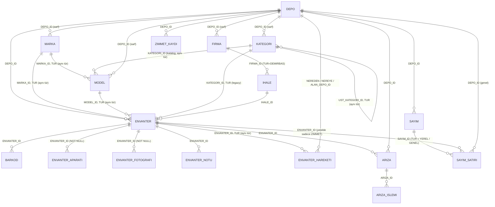

# AŞAMA 2 — Domain Tasarımı (DEPO → yeni şema)

> **Girdiler:** onaylı [asama0_legacy_ddl.sql](asama0_legacy_ddl.sql), [asama1_legacy_analiz.md](asama1_legacy_analiz.md) (StokTakip karşılaştırması 6. bölümde).
>
> **Bu aşamanın ana kısıtı:** Profilleme sonuçları, S1–S32 ve Ç1–Ç13 cevapları **gelmeyecek** (kullanıcı kararı, 2026-11-07). #8 (BYTE/CHAR) ve #9 (R_ARIZA trigger'ları) da açık kalıyor.
>
> Tasarım bu belirsizliklere **dayanıklı** olacak şekilde kuruldu. Hiçbir [ZAYIF TAHMİN] entity'ye ilişki veya enum olarak girmedi. Bu belirsizliklerin her biri için ne yapıldığı 1. bölümde.

---

## 1. Belirsizlik Altında Tasarım Kuralları

Her kuralın gerekçesi yanında. Bu kurallar Aşama 3 (entity) ve Aşama 4 (migration) için bağlayıcıdır.

### K1. Ham satırın tamamı saklanır
- Her legacy satır, okunan **bütün kolonlarıyla** (`SELECT *`) JSON olarak `MIG_HAM_VERI` tablosuna yazılır. Hedef tabloya giden satırlar da, reddedilenler de.
- **Gerekçe:** Hangi kolonun ne anlama geldiğini doğrulayamıyoruz. Yanlış yorumlanan bir değer en azından geri getirilebilir olmalı.
- Fotoğrafta görünmeyen ama canlıda bulunan kolonlar da (Ç3) böylece kaybolmaz.

### K2. İlişkiler etiketine göre üç şekilde modellenir

| Etiket | Hedef şemada karşılığı | Eşleşme bulunamazsa |
|---|---|---|
| **[KESİN]** (DDL'de tanımlı FK) | FK, NOT NULL | Legacy FK zaten zorladığı için olmaması gerekir. Olursa satır **RED** |
| **[KESİN: comment]** ve **[GÜÇLÜ]** | FK, **NULL olabilir** | FK NULL kalır, satır **taşınır**, `MIG_SORUN`'a **UYARI** (`ORPHAN_REF`). Ham değer `MIG_HAM_VERI`'de |
| **[ZAYIF]** | FK **yok**. Değer `..._ESKI_REF` adlı opak bir metin kolonunda **olduğu gibi** saklanır | — (çözümleme denenmez) |

- **Neden GÜÇLÜ ilişkiler NULL olabiliyor:** Legacy'de FK yok; orphan kayıt olup olmadığını bilmiyoruz. NOT NULL yaparsak orphan'ı olan her satırı reddetmek zorunda kalırız. Bir demirbaşın deposu silinmiş diye demirbaşı kaybetmek kabul edilemez.
- **Yeni kayıtlar için zorunluluk** (ör. "her demirbaşın bir deposu olur") uygulama katmanında doğrulanır, DB'de değil. Aşama 3'te ayrıca ele alınacak.
- **ZAYIF ilişkiler için** `_ESKI_REF` kolonu, ileride doğrulanırsa bir Flyway migration'ı ve backfill job'ıyla FK'ye yükseltilebilir. O zamana kadar domain bu değerlere anlam yüklemez.
- **Birden fazla eşleşme** (ebeveyn tarafında tekrarlı GUID; legacy'de tekillik yok): FK NULL kalır ve UYARI yazılır (`AMBIGUOUS_REF`). Rastgele birini seçmiyoruz.

### K3. Kod kolonları
- **Anlamı DDL comment'inde yazan kodlar** enum olur (`@Enumerated(STRING)`). Legacy kod → enum dönüşümü, Aşama 4'teki merkezi converter'da yapılır.
- **Eşleme tablosu yapılandırılabilir** (`application.yml`). Varsayılan değerler DDL comment'lerinden alınır.
- **Tanınmayan bir kod gelirse** satır **RED** olur. Rapor bu kodu listeler. Operatör eşlemeyi yml'ye ekler ve migration tekrar çalıştırılır (idempotent).
- **Gerekçe:**
  - Enum'a "BILINMIYOR" değeri koymak sessiz veri bozulmasıdır. StokTakip'te sayım kodlarının hepsi bu yüzden BILINMIYOR'a düşüyordu (Ç5).
  - Yeniden çalıştırma ucuz olduğu için reddetmek daha güvenli.
- **Anlamı bilinmeyen kodlar** ham değer olarak tutulur (`..._KODU`, tip legacy'deki gibi). Bunlar: `ASAMA`, `R_ARIZA_LOG.ISLEM`, `HNO`, `ALIM_TUR`, `BIRIM`, RESAT `DURUM`, `R_SARFDEMIRBAS.TUR`, puanlar, `YERINDE_GARANTI`, `ONARIM_SURESI`.

### K4. Kimlikler
- Her hedef tablo kendi sequence'inden yeni bir `ID NUMBER(19)` alır: `INCREMENT BY 50`, Hibernate tarafında `allocationSize = 50`.
- **Eski ID ve GUID'ler entity'de tutulmaz.** Sadece `MIG_KIMLIK_ESLEME` tablosunda durur.
  - **Gerekçe:** Legacy kimliklerin hiçbiri güvenilir değil. GUID NULL olabiliyor, tekrar edebiliyor; ID uygulama tarafından da verilebiliyor. Ayrıca domain modülünü legacy kavramlardan temiz tutmak istiyoruz.
- **Kaynak satır kimliği `ROWID`'dir.** Legacy tabloların 22'sinde PK yok ve ID/GUID tekrar edebilir; her satırda kesin olarak bulunan ve tekil olan tek değer ROWID.
  - **Varsayım:** Migration süresince legacy tablolar taşınmaz (`ALTER TABLE MOVE`, export/import yapılmaz). Taşınırsa ROWID'ler değişir ve tekrar çalıştırma her şeyi yeni satır sanır. Bu varsayım runbook'a (Aşama 4) yazılacak.

### K5. Metin
- **Hedef DB karakter seti AL32UTF8 olmalı (ön koşul).** Testcontainers'taki gvenzl/oracle-free imajı da AL32UTF8.
- Tüm metin kolonları `VARCHAR2(n CHAR)`, legacy uzunluğuyla aynı n. Legacy BYTE semantiğinde ise bile n karakter n byte'tan az olamaz. Bu yüzden #8'in cevabı ne olursa olsun veri sığar.
- **4000 uzunluğundaki NVARCHAR2 kolonlar CLOB olur:** `R_ARIZA.SEBEP`, `R_ARIZA_LOG.ACIKLAMA`, `R_SQL_KAYIT.ICERIK`.
  - **Gerekçe:** `VARCHAR2(4000 CHAR)` Türkçe karakterlerle 4000 byte sınırını aşar (`MAX_STRING_SIZE=STANDARD` iken).
- **Temizleme kuralları:**
  - `CHAR` kolonlar ve kod kolonları: sağdaki boşluklar silinir; tamamen boşsa NULL olur.
  - Serbest metin **değiştirilmez**.
  - Bozuk Türkçe karakter (Ý, Þ, Ð, ý, þ, ð) **sadece tespit edilir**: UYARI yazılır, otomatik düzeltme yapılmaz.
  - **Gerekçe:** Karakter seti bilinmediği için düzeltme kendisi bir tahmin olur.
- Büyük/küçük harf dönüşümünde her zaman `Locale.ROOT` kullanılır. `ALIM_TUR` gibi büyük/küçük harfe duyarlı kodlara hiç dokunulmaz.

### K6. Tarihler
- Legacy `DATE` → `LocalDateTime` → `TIMESTAMP(0)`.
  - **Gerekçe:** Hangi kolonun saat taşıdığını bilmiyoruz. `LocalDate`'e çevirmek saati kaybedebilir.
  - Saat dilimi dönüşümü yapılmaz. DATE'in kendisi saat dilimi bilgisi taşımıyor; `Instant`'a çevirmek 2016 DST kuralı hakkında bir tahmin gerektirir.
- Delphi'nin boş tarih değerleri (`1899-12-30` ve `1900-01-01`, saati 00:00) NULL olur ve UYARI yazılır. Ham değer `MIG_HAM_VERI`'de kalır.
- Yeni sistemin kendi audit alanları UTC `LocalDateTime` tipindedir (bkz. 4.1; Aşama 5 kararı). Legacy `K_TARIH`, audit alanı değil, bir domain alanı olarak (`KAYIT_TARIHI`) taşınır.

### K7. Personel
- Personel tablosu yok (S2 cevapsız). Bu yüzden personel bir entity değil.
- Sicil değerleri `Sicil` value object'i ile tutulur: tek bir metin kolonu, sadece trim uygulanır.
  - **Baştaki sıfırlar eklenmez ve silinmez.** Format bilinmiyor (S3).
  - `R_COKZIMMET.SICIL` NUMBER tipinde; olduğu gibi metne çevrilir.

### K8. Belirsiz birleştirmeler yapılmaz
- **Karar (2026-11-07): RESAT ↔ SARF marka, model ve firma tabloları ortak tablolarda tutulur:** `MARKA`, `MODEL`, `FIRMA`. `TUR` kolonu (`DEMIRBAS` / `SARF`, enum `MalzemeTuru`) satırları ayırır.
  - Bu bir **tablo** birleştirmesidir, **veri** birleştirmesi değildir: aynı ad iki tarafta da varsa iki satır kalır. Bu yüzden K8'in gerekçesi (geri dönüşsüz veri kararı) bu çiftlere uygulanmaz.
  - Türler arası yanlış bağlantı veritabanında engellenir: `MODEL(MARKA_ID, TUR) → MARKA(ID, TUR)`; `DEMIRBAS` ve `IHALE` tarafında sabit `'DEMIRBAS'` değerli sanal `TANIM_TURU` kolonu ile bileşik FK. Taraflara özgü zorunluluklar CHECK ile (sarf modelinde marka ve aktif, sarf firmasında ad, demirbaş firmasında durum kodu ve kayıt tarihi).
  - Tablo sayısı 27 → 24.
- **Karar (2026-11-07): `RESAT_SABIT_KOD` + `SARF_KATEGORI` → tek `KATEGORI` ağacı** (`TUR` ile; üst kayıt aynı türde, bileşik FK). Kullanıcı teyidi: sabit kod eski uygulamanın kategori ağacıdır (PARENT aynı tablodaki GUID'i gösterir). Yeni uygulamada kategori sahibinden.com tarzı bir **katalog** ağacıdır ve **modele** bağlıdır (`MODEL.KATEGORI_ID`).
  - Legacy'de kategori demirbaşın satırındadır (`R_DEMIRBAS.SABITKOD`; `RESAT_MODEL`'de SABITKOD yok, Ç2). Bu değer `DEMIRBAS.KATEGORI_ID`'de kayıpsız korunur.
  - `MODEL.KATEGORI_ID` migration'da türetilir: modelin demirbaşlarında tek bir dolu kategori varsa o yazılır; hiç yoksa ya da birden fazlaysa boş kalır ve `KATEGORI_BELIRSIZ` uyarısı yazılır. Kategorisi boş demirbaş çelişki sayılmaz. Sarf modelleri için kaynak yok, boş kalır.
  - Tablo sayısı 22 → 21.
- **Karar (2026-11-08): demirbaş ve sarf malzemesi tek `ENVANTER` tablosunda** (`TUR` = `DEMIRBAS` / `SARF`). Kullanıcı isteği: ayrı bir "sarf" entity'si olmasın.
  - `R_DEMIRBAS` → `ENVANTER` (TUR = DEMIRBAS). `R_TUKETIMCINSLERI` → `ENVANTER` (TUR = SARF): her tüketim cinsi bir sarf malzemesidir (Toner gibi).
  - `R_HAREKET` → `ENVANTER_HAREKETI` (TUR = DEMIRBAS); `R_SARFDEMIRBAS` → `ENVANTER_HAREKETI` (TUR = SARF): sarf malzemesinin stok hareketi, `ADI` → sarf envanterin GUID'i [GÜÇLÜ, StokTakip].
  - `SARF_LOG` → `ZIMMET_KAYDI`; `DEMIRBAS_NOTU` / `DEMIRBAS_APARATI` → `ENVANTER_NOTU` / `ENVANTER_APARATI`.
  - Yine tablo birleştirmesi, veri birleştirmesi değil: her legacy satırı tek bir hedef satıra gider, `MIG_HAM_VERI`'de kaynak tablosuyla durur.
  - Tür kuralları veritabanında: `CK_ENVANTER_DEMIRBAS` (durum ve kayıt tarihi zorunlu), `CK_ENVANTER_SARF` (ad zorunlu), `CK_ENV_HAREKETI_DEMIRBAS` (hareket no zorunlu); `ENVANTER_HAREKETI(ENVANTER_ID, TUR) → ENVANTER(ID, TUR)` ve `ENVANTER(KATEGORI/MARKA/MODEL_ID, TUR)` bileşik FK'leri türler arası bağlantıyı engeller. Entity'de aynı kurallar fabrika metotları (`Envanter.demirbas` / `Envanter.sarf`) ve setter kontrolleriyle.
  - Türe özgü kolonlar diğer türde boş kalır (ör. sarfta `DEMIRBAS_NO`, demirbaş hareketinde `MIKTAR`).
  - Tablo sayısı 21 → 19.
- **Karar (2026-11-08): `R_SAYIM_YEREL` + `R_SAYIM_GENEL` → tek `SAYIM_SATIRI`** (`TUR` = `YEREL` / `GENEL`, başlıktaki `SayimKapsami` enum'u). Kullanıcı isteği.
  - Yine tablo birleştirmesi, veri birleştirmesi değil: her legacy satırı bir hedef satıra gider, `MIG_HAM_VERI`'de kaynak tablosuyla durur.
  - ISLEM kod kümeleri farklı ('2' yerelde ZIMMET_DUZELTME, genelde DUZELTME): kodlar birleştirilmez. Tek `SayimIslemi` enum'u iki kümenin birleşimi; hangi değerin hangi türde geçerli olduğu `CK_SAYIM_SATIRI_ISLEM` ve `SayimIslemi.gecerliMi` ile korunur. yml'de iki ayrı eşleme kalır; başlangıçta her eşlemenin kendi türünde geçerli değer ürettiği doğrulanır.
  - Yereldeki eski `TUR` (Z/S) kolonu `MALZEME_TURU` adını aldı. `ITARIH` (yerel) ve `TARIH` (genel) tek `ISLEM_TARIHI` kolonunda; genelde zorunlu (`CK_SAYIM_SATIRI_GENEL`). Yerelde malzeme, zimmet ve malzeme türü zorunlu (`CK_SAYIM_SATIRI_YEREL`).
  - Satır türünün başlığın kapsamıyla (`SAYIM.KAPSAM`) aynı olması zorlanmaz: legacy'de bunun garanti olduğu doğrulanmadı [ZAYIF]; zorlamak veri reddine yol açabilirdi.
  - Tablo sayısı 19 → 18.
- `R_HAREKET` tek tablo; StokTakip gibi depo ve personel diye ikiye bölünmez (Ç7).
- **Gerekçe:** Birleştirme veri üzerinde bir karardır ve tek yönlüdür. Ayrı tutmak kayıpsızdır; ileride birleştirmek her zaman mümkün.

- **Karar (2026-11-08): soft delete, asla hard delete.** 19 domain tablosunun hepsinde `SILINME_ZAMANI` (UTC) ve `SILEN` (birlikte dolu ya da boş, `CK_<TABLO>_SILME`); her tabloda `BEFORE DELETE` trigger'ı (`TRG_<TABLO>_SILME_YASAK`) DELETE'i ORA-20001 ile reddeder. Entity: `BaseEntity.sil(silen)` / `geriAl()`, `@PreRemove` ile `remove()` reddi, silinmiş kayda yeni ilişki kurulamaz. Hibernate `silinmemis` filtresi otomatik açık (sorgular silinmişleri gizler), ID ile yüklemeye uygulanmaz (geçmiş bozulmaz). Kapak fotoğrafı tekil index'i silinmişleri saymaz. Hedef kullanıcıda `CREATE TRIGGER` yetkisi gerekir. S14 kapandı. Ayrıntı: HANDOFF.md 3.4.

### K9. Kapsam
- **Kapsam kararları (2026-11-07):** `R_APARAT` taşınmaz; `R_IADE_HAVUZU` ve `R_ARIZA_DEGERLENDIRME` **sadece arşivlenir**: hedef tablo yok, her legacy satırı ham JSON olarak `MIG_HAM_VERI`'de (`HEDEF_TABLO = 'ARSIV'`) saklanır, eşlemesi yazılır ve raporda `TAMAM (ARŞİV)` olarak görünür. Veri kaybolmaz ama yeni uygulamada görünmez. `R_COKZIMMET` ve `R_TUKETIMCINSLERI` taşınır.
- **24 tablo** hedef tabloya taşınır (Ç10'da benim varsayılanım). **`R_APARAT` karar gereği taşınmaz** (2026-11-07): yeni sistemde aparatlar demirbaşa bağlı `ENVANTER_APARATI` tablosunda tutulur (5.2). Kullanıcı teyidi (2026-11-08): eski aparatlar taşınmaz; yeni uygulamada bundan sonra eklenen ürünlerin aparatları bu tabloya girilir. Verisi sessizce kaybolmaz: her çalışmada satır sayısıyla `KAPSAM_DISI_KARAR` uyarısı olarak rapora yazılır.
- `R_IADE_ONAY_HAVUZU` (Ç4) ve `LOG_YAZ`'ın yazdığı tablo, DDL'leri olmadığı için **kapsam dışı.**
  - Migration başlarken legacy şemayı tarar. Beklenmeyen tablo ve kolonları satır sayılarıyla birlikte rapora **UYARI** olarak yazar. Böylece sessizce atlanmazlar.
- Delta (artımlı) migration yok. Tek seferlik geçiş, tekrar çalıştırılabilir (S7 cevapsız; en basit güvenli seçenek).

### K10. Profillemenin yerini kuru çalıştırma (dry-run) alır
- Migration önce **dry-run modunda** çalışır:
  - Hedef domain tablolarına yazmaz.
  - Sadece `MIG_SORUN` tablosunu ve raporu doldurur.
- Rapor, Aşama 1'deki profillemenin büyük kısmını kendiliğinden verir: orphan sayıları, tanınmayan kodlar, bozuk karakterler, boş tarih değerleri, belirsiz referanslar.
- Rapor iş yerinde kalır, **dışarı paylaşılması gerekmez.** Operatör yml eşlemelerini rapora göre düzeltir ve gerçek çalıştırmayı yapar.

---

## 2. Bounded Context'ler

| Context | Paket | Sorumluluk | Legacy kaynağı |
|---|---|---|---|
| **Tanım** | `...domain.tanim` | Depo, demirbaş markası/modeli, sabit kod ağacı, firma, ihale | `RESAT_*` |
| **Demirbaş** | `...domain.demirbas` | Demirbaş kalemi, barkod, not, hareket, aparat (yeni), çoklu zimmet | `R_DEMIRBAS*`, `R_BARKOD`, `R_HAREKET`, `R_COKZIMMET`, `R_IADE_HAVUZU` (`R_APARAT` taşınmaz) |
| **Arıza** | `...domain.ariza` | Arıza kaydı, işlem akışı, değerlendirme | `R_ARIZA*` |
| **Sayım** | `...domain.sayim` | Sayım başlığı, yerel ve genel sayım satırları | `R_SAYIM*` |
| **Sarf** | `...domain.sarf` | Sarf tanımları, tüketim cinsi, sarf hareketi, sarf zimmet kaydı | `SARF_*`, `R_TUKETIMCINSLERI`, `R_SARFDEMIRBAS` |
| **Sistem** | `...domain.sistem` | Kayıtlı SQL kayıtları | `R_SQL_KAYIT` |
| **Ortak** | `...domain.ortak` | `BaseEntity`, `Sicil`, `IletisimKisisi`, ortak converter'lar | — |
| **Migration** *(ayrı modül)* | `...migration` | Kimlik eşleme, sorun kaydı, ham veri, çalışma raporu | — |

**Context'ler arası ilişki kuralları:**
- Context'ler arası bağlantılar sadece `@ManyToOne(fetch = LAZY)`. Ters yönde koleksiyon (`@OneToMany`) **yok**.
  - **Gerekçe:** Hareket, barkod ve sayım satırı tabloları büyük. Çift yönlü koleksiyonlar istem dışı toplu yüklemeye ve proxy sorunlarına yol açar.
- Context içinde de varsayılan aynı. Koleksiyon gerekirse Aşama 3'te tek tek gerekçesiyle eklenir.
- Personel bir context değil; sadece `Sicil` değeri (K7).

---

## 3. ER Diyagramı

Sadece FK olarak modellenen ilişkiler çizildi. Hepsi NULL olabilir (K2); istisnalar: sarf modelinin markası (CHECK) ve `ENVANTER_APARATI → ENVANTER`. ZAYIF referanslar (`_ESKI_REF`) diyagramda yok.

Bağlantısız tablolar: `COKLU_ZIMMET`, `SQL_KAYDI`.

---

## 4. Ortak Yapılar

### 4.1 `BaseEntity` (`@MappedSuperclass`); her tabloda bulunan kolonlar

| Kolon | Tip | Java | Not |
|---|---|---|---|
| `ID` | `NUMBER(19)` PK | `Long` | Tablo başına sequence: `<TABLO>_SEQ`, `INCREMENT BY 50`, `allocationSize = 50` |
| `VERSIYON` | `NUMBER(10)` NOT NULL | `int` (`@Version`) | |
| `OLUSTURMA_ZAMANI` | `TIMESTAMP(6)` NOT NULL, UTC | `LocalDateTime` (`@CreatedDate`) | Migration satırlarında migration'ın çalıştığı an |
| `OLUSTURAN` | `VARCHAR2(36 CHAR)` NOT NULL | `String` (`@CreatedBy`) | Migration satırlarında `'MIGRATION'` |
| `GUNCELLEME_ZAMANI` | `TIMESTAMP(6)`, UTC | `LocalDateTime` (`@LastModifiedDate`) | |
| `GUNCELLEYEN` | `VARCHAR2(36 CHAR)` | `String` (`@LastModifiedBy`) | |

- **Aşama 5 kararı:** Başta `Instant` + `TIMESTAMP(6) WITH TIME ZONE` planlanmıştı. Hibernate 7.2 `Instant`ı TIMESTAMP_UTC koduyla eşliyor, Oracle sürücüsü ise bu kolonu -101 koduyla bildiriyor ve `validate` başarısız oluyor. Bu yüzden audit alanları UTC `LocalDateTime` + `TIMESTAMP(6)` oldu; zamanı uygulamanın `DateTimeProvider`ı UTC olarak verir.
- `equals`/`hashCode` sadece `ID` üzerinden, proxy-safe. Lombok `@Data` kullanılmıyor.

### 4.2 Value object'ler (`@Embeddable`)

| VO | Alanlar | Nerede |
|---|---|---|
| `Sicil` | `deger` | Tek kolonlu. Her kullanıldığı yerde kolon adı ve uzunluğu `@AttributeOverride` ile verilir |
| `IletisimKisisi` | `ad`, `telefon` | `FIRMA` (iki tür): yetkili ve irtibat kişileri (iki kez gömülü) |
| `GarantiSuresi` | `baslangic`, `bitis` | `DEMIRBAS` |
| `IhaleKomisyonu` | `baskan`, `uye1`, `uye2` | `IHALE`. Koleksiyon yapılmadı: komisyon hep 3 kişi mi bilinmiyor (S29); 3 sabit alan kayıpsız |
| `MalzemeAnlikGorunumu` | `ad`, `marka`, `model`, `seriNo` | `SAYIM_SATIRI` (GENEL): sayım anındaki metin kopyası. MARKA ve MODEL'e **çözümleme yapılmaz**; GUID mi isim mi olduğu belli değil |

### 4.3 Enum'lar (K3: varsayılan eşlemeler DDL comment'lerinden)

| Enum | Legacy kolon | Varsayılan eşleme | Kaynak |
|---|---|---|---|
| `AlimYolu` | `R_DEMIRBAS.ALIM_YOLU` | 0 `BILGI_ISLEM_DB`, 1 `IKMAL_BAKIM_DB`, 2 `HABERLESME_DB`, 3 `HABERALMA_OD`, 4 `KAYNAGI_BELIRSIZ` | KESİN: comment |
| `DemirbasDurumu` | `R_DEMIRBAS.DURUM` (CHAR(3), trim) | '1' `NORMAL`, '2' `ARIZALI`, '3' `IADE` | KESİN: comment (1, 2); 3 Delphi kodundan, 2026-11-12 (V3) |
| ~~`IadeDurumu`~~ | `R_IADE_HAVUZU.DURUM` | Kaldırıldı: tablo sadece arşivlenir (K9) | — |
| `ArizaIslemTuru` | `R_ARIZA_LOG.TUR` | 1 `ISLEM`, 2 `BILGI`, 3 `SIKAYET`, 4 `TESEKKUR` | KESİN: comment |
| `SayimKapsami` | `R_SAYIM.TUR` | 'Y' `YEREL`, 'G' `GENEL` | KESİN: comment |
| `SayimDurumu` | `R_SAYIM.DURUM` | 0 `DEVAM_EDIYOR`, 1 `TAMAMLANDI` | KESİN: comment |
| `SayimIslemi` (YEREL) | `R_SAYIM_YEREL.ISLEM` | '0' `SAYILMADI`, '1' `SAYILDI`, '2' `ZIMMET_DUZELTME`, '3' `REZERVE` | KESİN: comment |
| `YerelSayimTuru` | `R_SAYIM_YEREL.TUR` | 'Z' `ZIMMET`, 'S' `SARF` | KESİN: comment |
| `SayimIslemi` (GENEL) | `R_SAYIM_GENEL.ISLEM` | '0' `SAYILMADI`, '1' `SAYILDI`, '2' `DUZELTME` | KESİN: comment |
| `SarfZimmetIslemi` | `SARF_LOG.ISLEM` (CHAR(6), trim) | 'ZİMMET' `ZIMMET`, 'DÜŞÜM' `DUSUM` | KESİN: comment |

**Enum değil, boolean olanlar:**
- `R_BARKOD.SERIMI` → `seriNoMu`. Varsayılan eşleme `'H'` → false, `'E'` → true [GÜÇLÜ: DEFAULT 'H'].
- `SARF_*.AKTIF` → `aktif`. Varsayılan eşleme 1 → true, 0 → false [GÜÇLÜ: kolon adı].

Bu iki boolean'da da tanınmayan değer gelirse satır RED (K3).

---

## 5. Tablo ve Kolon Eşlemesi

**Notasyon:**
- **→ MAP**: değer sadece `MIG_KIMLIK_ESLEME` tablosuna gider (entity'de yok).
- **FK?**: NULL olabilen FK (K2).
- **REF**: opak `_ESKI_REF` metni (ZAYIF).
- **ham**: anlamı bilinmeyen kod, olduğu gibi saklanır.
- **Her** legacy satır ayrıca `MIG_HAM_VERI`'ye yazılır (K1). Tabloda tekrar belirtilmedi.

### 5.1 Tanım

**`RESAT_DEPO` → `DEPO`**

| Legacy | Hedef | Tip | Kural |
|---|---|---|---|
| ID | → MAP | | |
| GUID | → MAP | | Legacy'de UNIQUE [KESİN]; diğer tablolar buna bağlanıyor |
| ADI | AD | VARCHAR2(50 CHAR) NN | |
| ACIKLAMA | ACIKLAMA | VARCHAR2(200 CHAR) | |
| DURUM | DURUM_KODU | VARCHAR2(1 CHAR) | ham (S28) |
| K_TARIH | KAYIT_TARIHI | TIMESTAMP(0) | |
| PERSONELKODU | SORUMLU_SICIL | VARCHAR2(10 CHAR) | `Sicil` |

**`RESAT_MARKA` → `MARKA` (TUR = DEMIRBAS)**

| Legacy | Hedef | Tip | Kural |
|---|---|---|---|
| ID, GUID | → MAP | | |
| ADI | AD | VARCHAR2(50 CHAR) NN | |
| ACIKLAMA | ACIKLAMA | VARCHAR2(200 CHAR) | |
| DURUM | DURUM_KODU | VARCHAR2(1 CHAR) | ham |
| K_TARIH | KAYIT_TARIHI | TIMESTAMP(0) | |

**`RESAT_MODEL` → `MODEL` (TUR = DEMIRBAS)**

| Legacy | Hedef | Tip | Kural |
|---|---|---|---|
| ID, GUID | → MAP | | |
| ADI | AD | VARCHAR2(50 CHAR) NN | |
| ACIKLAMA | ACIKLAMA | VARCHAR2(200 CHAR) | |
| DURUM | DURUM_KODU | VARCHAR2(1 CHAR) | ham |
| K_TARIH | KAYIT_TARIHI | TIMESTAMP(0) | |
| PARENT | MARKA_ID | FK? → MARKA (aynı tür) | GÜÇLÜ (index adı + repo) |

**`RESAT_SABIT_KOD` → `KATEGORI` (TUR = DEMIRBAS)**

| Legacy | Hedef | Tip | Kural |
|---|---|---|---|
| ID, GUID | → MAP | | |
| PARENT | UST_KATEGORI_ID | FK? → KATEGORI (aynı tür) | GÜÇLÜ. İki geçişte çözülür (önce tüm satırlar, sonra parent'lar). Kendisini gösteriyorsa ya da tabloda bulunamıyorsa kök kabul edilir: NULL + UYARI `ROOT_OR_ORPHAN` (Ç12) |
| AD | AD | VARCHAR2(50 CHAR) NN | |
| YORUM | YORUM | VARCHAR2(100 CHAR) | |
| DURUM | DURUM_KODU | VARCHAR2(1 CHAR) NN | ham |
| K_TARIH | KAYIT_TARIHI | TIMESTAMP(0) | |

**`RESAT_FIRMA` → `FIRMA` (TUR = DEMIRBAS)**

| Legacy | Hedef | Tip | Kural |
|---|---|---|---|
| ID, GUID | → MAP | | |
| FIRMA_ADI | AD | VARCHAR2(50 CHAR) | Legacy'de NULL olabiliyor; hedefte de olabilir |
| YETKILI, YETKILITEL | YETKILI_AD, YETKILI_TELEFON | VARCHAR2(50/30 CHAR) | `IletisimKisisi` |
| IRTIBAT, IRTIBATTEL | IRTIBAT_AD, IRTIBAT_TELEFON | VARCHAR2(50/30 CHAR) | `IletisimKisisi` |
| TEL1, TEL2, FAX | TELEFON1, TELEFON2, FAKS | VARCHAR2(30 CHAR) | |
| WEB | WEB_ADRESI | VARCHAR2(100 CHAR) | |
| ADRES | ADRES | VARCHAR2(250 CHAR) | |
| NOTLAR | NOTLAR | VARCHAR2(300 CHAR) | |
| DURUM | DURUM_KODU | VARCHAR2(1 CHAR) NN | ham |
| K_TARIH | KAYIT_TARIHI | TIMESTAMP(0) NN | |

**`RESAT_IHALE` → `IHALE`**

| Legacy | Hedef | Tip | Kural |
|---|---|---|---|
| ID, GUID | → MAP | | |
| IHALE_ADI | AD | VARCHAR2(50 CHAR) | |
| IHALE_TAR, KABUL_TAR, SOZ_TAR | IHALE_TARIHI, KABUL_TARIHI, SOZLESME_TARIHI | TIMESTAMP(0) | |
| BIRIM | BIRIM_KODU | NUMBER | ham (S9) |
| PERSONEL | PERSONEL_METNI | VARCHAR2(50 CHAR) | Sicil mi isim mi bilinmiyor (S29) → metin |
| FIRMA_ID | FIRMA_ID | FK? → FIRMA | GÜÇLÜ |
| ACIKLAMA | ACIKLAMA | VARCHAR2(200 CHAR) | |
| DURUM | DURUM_KODU | VARCHAR2(1 CHAR) NN | ham |
| K_TARIH | KAYIT_TARIHI | TIMESTAMP(0) NN | |
| KOM_BASKANI, UYE1, UYE2 | KOMISYON_BASKANI, KOMISYON_UYE1, KOMISYON_UYE2 | VARCHAR2(100 CHAR) | `IhaleKomisyonu` |
| YERINDE_GARANTI | YERINDE_GARANTI_KODU | NUMBER | ham (birimi bilinmiyor, S15) |
| ONARIM_SURESI | ONARIM_SURESI_KODU | NUMBER | ham |

### 5.2 Demirbaş

**`R_DEMIRBAS` → `ENVANTER` (TUR = DEMIRBAS)**

| Legacy | Hedef | Tip | Kural |
|---|---|---|---|
| ID, GUID | → MAP | | GUID NULL olabilir: bu satır taşınır ama başka hiçbir tablo ona bağlanamaz. Tekrarlı GUID'lere yapılan referanslar → `AMBIGUOUS_REF` |
| D_NO | DEMIRBAS_NO | NUMBER(19) | Tekil **değil** (S8 cevapsız). Kesirli değer gelirse RED |
| SERI_NO | SERI_NO | VARCHAR2(50 CHAR) | index |
| BIRIM | BIRIM_KODU | NUMBER | ham |
| SABITKOD | KATEGORI_ID | FK? → KATEGORI (TUR=DEMIRBAS) | GÜÇLÜ (Ç2'de DDL esas). Modelin katalog kategorisi bundan türetilir (K8 kararı) |
| DEPO_GUID | DEPO_ID | FK? → DEPO | GÜÇLÜ |
| ALIM_YOLU | ALIM_YOLU | VARCHAR2(30 CHAR) | `AlimYolu` |
| M_ADI | AD | VARCHAR2(75 CHAR) | |
| MARKA | MARKA_ID | FK? → MARKA (TUR=DEMIRBAS) | GÜÇLÜ. Modelin markasıyla çelişirse UYARI `MARKA_MODEL_CELISKI`; ikisi de korunur |
| MODEL | MODEL_ID | FK? → MODEL (TUR=DEMIRBAS) | GÜÇLÜ |
| IHALE_ID | IHALE_ID | FK? → IHALE | GÜÇLÜ |
| G_BAS_TAR, G_BIT_TAR | GARANTI_BASLANGIC, GARANTI_BITIS | TIMESTAMP(0) | `GarantiSuresi` |
| ACIKLAMA | ACIKLAMA | VARCHAR2(200 CHAR) | |
| DURUM | DURUM | VARCHAR2(20 CHAR) NN | `DemirbasDurumu`; boşluklar silinir |
| K_TARIH | KAYIT_TARIHI | TIMESTAMP(0) NN | |
| SAYMANLIKNO | SAYMANLIK_NO | VARCHAR2(50 CHAR) | |
| PERSZIMMET | ZIMMETLI_SICIL | VARCHAR2(7 CHAR) | `Sicil` |
| ILSUBEDBASNO | IL_SUBE_DAIRE_BSK_NO | VARCHAR2(36 CHAR) | |
| ALIM_TUR | ALIM_TURU_KODU | VARCHAR2(1 CHAR) | ham, **büyük/küçük harfe duyarlı** ('i') |

**`R_BARKOD` → `BARKOD`** (bir demirbaşa birden çok barkod olabilir; StokTakip'teki "tek barkod" varsayımı kullanılmıyor, Ç9)

| Legacy | Hedef | Tip | Kural |
|---|---|---|---|
| ID | → MAP | | |
| MGUID | DEMIRBAS_ID | FK? → DEMIRBAS | GÜÇLÜ |
| BARKOD | BARKOD | VARCHAR2(50 CHAR) NN | index, **tekil değil** |
| SERIMI | SERI_NO_MU | NUMBER(1) NN | boolean (4.3) |

**`R_DEMIRBAS_ACIKLAMA` → `ENVANTER_NOTU`**

| Legacy | Hedef | Tip | Kural |
|---|---|---|---|
| ID | → MAP | | |
| MGUID | DEMIRBAS_ID | FK? → DEMIRBAS | GÜÇLÜ |
| ACIKLAMA | NOT_METNI | VARCHAR2(1000 CHAR) | |
| ZIMMETSAHIBI | ZIMMET_SAHIBI_METNI | VARCHAR2(500 CHAR) | o anki değerin kopyası; çözümlenmez |
| K_TARIH | KAYIT_TARIHI | TIMESTAMP(0) | |
| EKLEYEN | EKLEYEN_ADI | VARCHAR2(123 CHAR) | o anki değerin kopyası |
| EKLEYENSICIL | EKLEYEN_SICIL | VARCHAR2(7 CHAR) | `Sicil` |

**`R_HAREKET` → `ENVANTER_HAREKETI` (TUR = DEMIRBAS)** (K8)

| Legacy | Hedef | Tip | Kural |
|---|---|---|---|
| ID | → MAP | | NULL olabilir; ROWID ile tanımlanır (K4) |
| MGUID | DEMIRBAS_ID | FK? → DEMIRBAS | GÜÇLÜ |
| ADI | HAREKET_ADI | VARCHAR2(50 CHAR) | ham |
| NERDEN | NEREDEN_METNI | VARCHAR2(200 CHAR) | **her zaman** olduğu gibi saklanır |
| NERDEN | NEREDEN_DEPO_ID | FK? → DEPO | Sadece değer bir depo GUID'iyle eşleşirse dolar. Eşleşmezse UYARI **yazılmaz**: değer serbest metin de olabilir (Ç7) |
| NEREYE | NEREYE_METNI, NEREYE_DEPO_ID | (aynı) | (aynı) |
| KULLANICI | ISLEM_YAPAN_SICIL | VARCHAR2(6 CHAR) | `Sicil` |
| ACIKLAMA | ACIKLAMA | VARCHAR2(1000 CHAR) | |
| K_TARIH | KAYIT_TARIHI | TIMESTAMP(0) | |
| HNO | HAREKET_NO_KODU | NUMBER NN | ham |

**`ENVANTER_APARATI`** (yeni sistemin tablosu, legacy kaynağı yok; karar 2026-11-07, Flyway V2)

Bir demirbaşla birlikte gelen aparatlar (şarj adaptörü, kablo gibi). Bir demirbaşın birden fazla aparatı olabilir; her aparat tek bir demirbaşa aittir. Legacy `R_APARAT` demirbaşa bağlı değildi (Ç13) ve **taşınmaz** (K9).

| Kolon | Tip | Kural |
|---|---|---|
| DEMIRBAS_ID | NUMBER(19) NN → DEMIRBAS | FK NN. Demirbaşsız aparat olmaz. Index'li |
| AD | VARCHAR2(100 CHAR) NN | Boş olamaz (CHECK + entity) |
| ADET | NUMBER(10) NN, varsayılan 1 | En az 1 (CHECK + entity) |
| SERI_NO | VARCHAR2(50 CHAR) | İsteğe bağlı |
| ACIKLAMA | VARCHAR2(500 CHAR) | İsteğe bağlı |

İlişki diğer alt tablolar gibi tek yönlüdür (`DemirbasAparati.demirbas`, LAZY); `Demirbas`'ta koleksiyon yok.

**`ENVANTER_FOTOGRAFI`** (yeni sistemin tablosu, legacy kaynağı yok; karar 2026-11-08)

Yeni uygulamada ürün eklenirken fotoğrafı da eklenir. Bir envanterin (demirbaş ya da sarf) birden fazla fotoğrafı olabilir; her fotoğraf tek bir envantere aittir. Dosyanın kendisi **veritabanında değil**, S3 uyumlu nesne deposunda durur (kurumda Huawei OceanStor Pacific düşünülüyor, kesinleşmedi). Tabloda nesnenin anahtarı ve dosya bilgisi tutulur; URL ve bucket adı bilerek tutulmaz (adres ve ortam değişebilir, anahtar değişmez).

| Kolon | Tip | Kural |
|---|---|---|
| ENVANTER_ID | NUMBER(19) NN → ENVANTER | FK NN. Envantersiz fotoğraf olmaz. Index'li (ENVANTER_ID, SIRA) |
| NESNE_ANAHTARI | VARCHAR2(500 CHAR) NN, UNIQUE | Depodaki nesne anahtarı (ör. `envanter/1001/<uuid>.jpg`); değişmez |
| DOSYA_ADI | VARCHAR2(255 CHAR) NN | Yüklenen dosyanın özgün adı |
| ICERIK_TURU | VARCHAR2(100 CHAR) NN | `image/jpeg`, `image/png`, `image/webp`, `image/heic` (CHECK + entity) |
| BOYUT | NUMBER(19) NN | Bayt; sıfırdan büyük |
| SHA256 | VARCHAR2(64 CHAR) NN | Dosya özeti (64 haneli küçük harf onaltılık); bütünlük doğrulaması ve çift yükleme tespiti |
| GENISLIK, YUKSEKLIK | NUMBER(10) | Piksel; bilinmiyorsa boş, verilirse sıfırdan büyük |
| SIRA | NUMBER(10) NN, varsayılan 0 | Gösterim sırası |
| KAPAK | NUMBER(1) NN, varsayılan 0 | Envanter başına **en fazla bir** kapak (fonksiyon tabanlı tekil index `UX_ENVANTER_FOTOGRAFI_KAPAK`) |
| ACIKLAMA | VARCHAR2(500 CHAR) | İsteğe bağlı |

Uygulama servisinin sorumlulukları (backend'de): yükleme sırası önce nesne, sonra satır (satır yazılamazsa nesne silinir); silme sırası önce satır, sonra nesne; kapağı değiştirmek eski ve yeni kapağı tek işlemde günceller; depoda sahipsiz kalan nesneler anahtar listesiyle karşılaştırılıp temizlenir.
**`R_COKZIMMET` → `COKLU_ZIMMET`**

| Legacy | Hedef | Tip | Kural |
|---|---|---|---|
| ZSNO | ZIMMET_NO_ESKI_REF | NUMBER NN | REF (ZAYIF: neyin numarası bilinmiyor, S12) |
| SICIL | SICIL | VARCHAR2(40 CHAR) NN | `Sicil`; NUMBER → metin |

**`R_IADE_HAVUZU` → sadece arşiv (K9, 2026-11-07).** Aşağıdaki eşleme artık uygulanmıyor; tarihçe için duruyor.

| Legacy | Hedef | Tip | Kural |
|---|---|---|---|
| ID | → MAP | | Değerin kaynağı bilinmiyor; demirbaş ID'si olabilir [ZAYIF]. Sadece eşleme tablosunda tutulur |
| MGUID | DEMIRBAS_ID | FK? → DEMIRBAS | GÜÇLÜ |
| DURUM | DURUM | VARCHAR2(20 CHAR) NN | `IadeDurumu` |
| TARIH | ISLEM_TARIHI | TIMESTAMP(0), genelde zorunlu | |

### 5.3 Arıza

**`R_ARIZA` → `ARIZA`**

| Legacy | Hedef | Tip | Kural |
|---|---|---|---|
| GUID | → MAP | | |
| KULLANICI | BILDIREN_SICIL | VARCHAR2(36 CHAR) NN | `Sicil` |
| DEPO | DEPO_ID | FK? → DEPO | GÜÇLÜ |
| MGUID | DEMIRBAS_ID | FK? → DEMIRBAS | GÜÇLÜ (aparat ihtimali S24 açık; eşleşmeyen değer `MIG_HAM_VERI`'de) |
| SEBEP | SEBEP | CLOB NN | K5 |
| ASAMA | ASAMA_KODU | NUMBER NN | ham (S22) |
| TARIH | TARIH | TIMESTAMP(0) NN | |
| MIAD | MIAD | TIMESTAMP(0) | |
| TESLIM | TESLIM_TARIHI | TIMESTAMP(0) | |
| ILETISIMTEL | ILETISIM_TELEFONU | VARCHAR2(15 CHAR) | |

**`R_ARIZA_LOG` → `ARIZA_ISLEMI`**

| Legacy | Hedef | Tip | Kural |
|---|---|---|---|
| GUID | → MAP | | `R_ARIZA_DEGERLENDIRME.ISLEM` buna bağlanıyor |
| AGUID | ARIZA_ID | FK? → ARIZA | KESİN: comment |
| ISLEM | ISLEM_KODU | NUMBER NN | ham |
| KULLANICI | ISLEM_YAPAN_SICIL | VARCHAR2(36 CHAR) NN | `Sicil` |
| GOREVLI | GOREVLI_SICIL | VARCHAR2(36 CHAR) NN | `Sicil` |
| ZAMAN | ZAMAN | TIMESTAMP(0) NN | |
| MIAD | MIAD | TIMESTAMP(0) NN | |
| ACIKLAMA | ACIKLAMA | CLOB | K5 |
| TUR | TUR | VARCHAR2(20 CHAR) NN | `ArizaIslemTuru` |
| SN | SIRA_NO | NUMBER | Legacy sırası korunur; yeni kayıtlarda kullanılmayacak |

**`R_ARIZA_DEGERLENDIRME` → sadece arşiv (K9, 2026-11-07).** Aşağıdaki eşleme artık uygulanmıyor; tarihçe için duruyor.

| Legacy | Hedef | Tip | Kural |
|---|---|---|---|
| AGUID | ARIZA_ID | FK? → ARIZA | KESİN: comment |
| ISLEM | ARIZA_ISLEMI_ID | FK? → ARIZA_ISLEMI | GÜÇLÜ: comment |
| TAMIR, FIRMA, GOREVLI, ARIZA | TAMIR_PUANI, FIRMA_PUANI, GOREVLI_PUANI, ARIZA_SEBEBI_KODU | NUMBER NN | ham (S23) |

### 5.4 Sayım

**`R_SAYIM` → `SAYIM`**

| Legacy | Hedef | Tip | Kural |
|---|---|---|---|
| ID | → MAP | | NVARCHAR2, NULL olabilir; satırlar buna bağlanıyor |
| TUR | KAPSAM | VARCHAR2(20 CHAR) NN | `SayimKapsami` |
| BASLIK | BASLIK | VARCHAR2(60 CHAR) NN | |
| BASTAR, BITTAR | BASLANGIC_TARIHI, BITIS_TARIHI | TIMESTAMP(0) | |
| DEPO | DEPO_ID | FK? → DEPO | GÜÇLÜ |
| DURUM | DURUM | VARCHAR2(20 CHAR) | `SayimDurumu` (legacy'de NULL olabiliyor) |

**`R_SAYIM_YEREL` → `SAYIM_SATIRI` (TUR = YEREL)**

| Legacy | Hedef | Tip | Kural |
|---|---|---|---|
| SAYIM | SAYIM_ID | FK? → SAYIM | GÜÇLÜ |
| MALZEME | MALZEME_ESKI_REF | VARCHAR2(36 CHAR) NN | REF, **her zaman** saklanır |
| MALZEME | ENVANTER_ID | FK? → ENVANTER | **Sadece TUR='Z'** satırlarda çözülür [GÜÇLÜ: comment + repo]. TUR='S' satırlarda çözülmez [ZAYIF] (Ç8) |
| ZIMMET | ZIMMET_ESKI_REF | VARCHAR2(36 CHAR) NN | REF (ZAYIF) |
| ISLEM | ISLEM | VARCHAR2(20 CHAR) NN | `SayimIslemi`, yerel kümesi |
| ITARIH | ISLEM_TARIHI | TIMESTAMP(0) | |
| TUR | MALZEME_TURU | VARCHAR2(20 CHAR), yerelde zorunlu | `YerelSayimTuru` |

**`R_SAYIM_GENEL` → `SAYIM_SATIRI` (TUR = GENEL)**

| Legacy | Hedef | Tip | Kural |
|---|---|---|---|
| SAYIM | SAYIM_ID | FK? → SAYIM | GÜÇLÜ |
| MALZEME | ENVANTER_ID | FK? → ENVANTER | GÜÇLÜ |
| DEPO | DEPO_ID | FK? → DEPO | GÜÇLÜ |
| ISLEM | ISLEM | VARCHAR2(20 CHAR) NN | `SayimIslemi`, genel kümesi |
| TARIH | TARIH | TIMESTAMP(0) NN | |
| M_ADI, MARKA, MODEL, SERI_NO | ANLIK_AD, ANLIK_MARKA, ANLIK_MODEL, ANLIK_SERI_NO | VARCHAR2(75/50/50/50 CHAR) | `MalzemeAnlikGorunumu` |
| ACIKLAMA | ACIKLAMA | VARCHAR2(150 CHAR) | |
| MERKEZNOT | MERKEZ_NOTU | VARCHAR2(150 CHAR) | |

### 5.5 Sarf

**`SARF_MARKA` → `MARKA` (TUR = SARF)**

| Legacy | Hedef | Tip | Kural |
|---|---|---|---|
| ID | → MAP | | Legacy PK [KESİN] |
| AD | AD | VARCHAR2(255 CHAR) NN | |
| AKTIF | AKTIF | NUMBER(1) NN | boolean |
| DEPO | DEPO_ID | FK? → DEPO | GÜÇLÜ |

**`SARF_MODEL` → `MODEL` (TUR = SARF)**

| Legacy | Hedef | Tip | Kural |
|---|---|---|---|
| GID | → MAP | | Legacy PK [KESİN]; yeni şemada GUID kolonu yok (eşleme tablosunda) |
| MARKA | MARKA_ID | **FK NN** → SARF_MARKA | KESİN (legacy FK). Hedefte `ON DELETE CASCADE` **yok** |
| AD | AD | VARCHAR2(255 CHAR) NN | |
| AKTIF | AKTIF | NUMBER(1) NN | boolean |
| DEPO | DEPO_ID | FK? → DEPO | GÜÇLÜ |

**`SARF_KATEGORI` → `KATEGORI` (TUR = SARF)**

| Legacy | Hedef | Tip | Kural |
|---|---|---|---|
| GUID | → MAP | | |
| PARENT | UST_KATEGORI_ID | FK? → SARF_KATEGORI | GÜÇLÜ; `SABIT_KOD` ile aynı iki geçişli kök kuralı |
| TITLE | BASLIK | VARCHAR2(20 CHAR) NN | |
| DEPO | DEPO_ID | FK? → DEPO | GÜÇLÜ |

**`SARF_FIRMA` → `FIRMA` (TUR = SARF)**

| Legacy | Hedef | Tip | Kural |
|---|---|---|---|
| GUID | → MAP | | Legacy PK [KESİN] |
| AD | AD | VARCHAR2(255 CHAR) NN | |
| YETKILI, YETKILI_TEL | YETKILI_AD, YETKILI_TELEFON | VARCHAR2(255/50 CHAR) | `IletisimKisisi` |
| IRTIBAT, IRTIBAT_TEL | IRTIBAT_AD, IRTIBAT_TELEFON | VARCHAR2(255/255 CHAR) | `IletisimKisisi` |
| TEL1, TEL2, FAX | TELEFON1, TELEFON2, FAKS | VARCHAR2(50 CHAR) | |
| WEB | WEB_ADRESI | VARCHAR2(255 CHAR) | |
| ADRES | ADRES | VARCHAR2(255 CHAR) | |
| NOTE | NOTLAR | VARCHAR2(255 CHAR) | |
| DEPO | DEPO_ID | FK? → DEPO | GÜÇLÜ |

`IletisimKisisi` VO'su iki firma tablosunda farklı uzunluklarla kullanılıyor. Uzunluklar her tabloda `@AttributeOverride` ile legacy'deki gibi verilecek.

**`R_TUKETIMCINSLERI` → `ENVANTER` (TUR = SARF)** (K8, 2026-11-08: her tüketim cinsi bir sarf malzemesi)

| Legacy | Hedef | Tip | Kural |
|---|---|---|---|
| ID, GUID | → MAP | | |
| ADI | AD | VARCHAR2(100 CHAR) NN | |
| ACIKLAMA | ACIKLAMA | VARCHAR2(200 CHAR) | |
| DURUM | DURUM_KODU | VARCHAR2(1 CHAR) | ham |
| K_TARIH | KAYIT_TARIHI | TIMESTAMP(0) | |

**`R_SARFDEMIRBAS` → `ENVANTER_HAREKETI` (TUR = SARF)**

| Legacy | Hedef | Tip | Kural |
|---|---|---|---|
| ID, GUID | → MAP | | |
| ADI | ENVANTER_ID | FK? → ENVANTER (TUR = SARF) | GÜÇLÜ (repo, 6.2) |
| MARKA, MODEL, FIRMA | MARKA_ESKI_REF, MODEL_ESKI_REF, FIRMA_ESKI_REF | VARCHAR2(36 CHAR) | REF (ZAYIF: RESAT mı SARF mı bilinmiyor) |
| ADET | MIKTAR | NUMBER(19,4) | `BigDecimal`. Sayıya çevrilemezse MIKTAR NULL + UYARI `SAYI_DEGIL` (ham değer `MIG_HAM_VERI`'de) |
| TUR | YON_KODU | VARCHAR2(36 CHAR) | ham (Ç6: yön mü, başka bir şey mi bilinmiyor) |
| SERINO | SERI_NO | VARCHAR2(200 CHAR) | |
| A_TARIH | ALIM_TARIHI | TIMESTAMP(0) | |
| ACIKLAMA | ACIKLAMA | VARCHAR2(200 CHAR) | |
| DURUM | DURUM_KODU | VARCHAR2(1 CHAR) | ham |
| K_TARIH | KAYIT_TARIHI | TIMESTAMP(0) | |
| ALANDEPO | ALAN_DEPO_ID | FK? → DEPO | GÜÇLÜ |

Stok miktarı tutulmuyor. TUR'un anlamı doğrulanmadan stok hesabı yapılmayacak; bu bir Aşama 3 sonrası iş kuralı.

**`SARF_LOG` → `ZIMMET_KAYDI`**

| Legacy | Hedef | Tip | Kural |
|---|---|---|---|
| ID | → MAP | | Legacy PK [KESİN] |
| SICIL | SICIL | VARCHAR2(7 CHAR) NN | `Sicil` |
| BILGI | BILGI | VARCHAR2(100 CHAR) | |
| ISLEM | ISLEM | VARCHAR2(20 CHAR) NN | `SarfZimmetIslemi`. Bozuk karakterli varyantlar ('ZÝMMET' gibi) yml'den eşleme olarak eklenebilir |
| MALZEME | MALZEME_ESKI_REF | VARCHAR2(36 CHAR) | REF (ZAYIF, Ç11) |
| DEPO | DEPO_ID | FK? → DEPO | GÜÇLÜ |
| TARIH | TARIH | TIMESTAMP(0) | |
| KULLANICI | ISLEM_YAPAN_SICIL | VARCHAR2(36 CHAR) | `Sicil` |

### 5.6 Sistem

**`R_SQL_KAYIT` → `SQL_KAYDI`** (adı tarafsız seçildi, S30 cevapsız)

| Legacy | Hedef | Tip | Kural |
|---|---|---|---|
| ID, GUID | → MAP | | |
| ADI | AD | VARCHAR2(50 CHAR) NN | |
| ICERIK | ICERIK | CLOB | K5 |
| KULLANICI | KULLANICI_SICIL | VARCHAR2(10 CHAR) | `Sicil` |
| DURUM | DURUM_KODU | VARCHAR2(1 CHAR) | ham |
| K_TARIH | KAYIT_TARIHI | TIMESTAMP(0) | |

### 5.7 Eşleme sağlaması

| | Sayı |
|---|---|
| Legacy tablo | 24 hedef tabloya taşınır → 17 hedef tablo (kategori, marka, model ve firma çiftleri TUR ile ortak tablolarda; demirbaş ve sarf malzemesi `ENVANTER`'de, hareketleri `ENVANTER_HAREKETI`'nde; yerel ve genel sayım satırları `SAYIM_SATIRI`'nda; veri birleştirmesi yok). 2 tablo sadece arşivlenir, `R_APARAT` taşınmaz (K9). Hedefte ayrıca yeni `ENVANTER_APARATI` ve `ENVANTER_FOTOGRAFI`; toplam 19 tablo |
| Legacy kolon | 217 taşınan (225 eksi `R_APARAT`'ın 8 kolonu; 0.16'daki listeyle aynı küme). Her biri yukarıda bir hedef kolona ya da MAP'e gidiyor. Ayrıca hepsi `MIG_HAM_VERI`'de |
| FK | 29 (bileşik FK'ler dahil). Zorunlu: `ENVANTER_APARATI.ENVANTER_ID`, `ENVANTER_FOTOGRAFI.ENVANTER_ID` (NOT NULL) ve sarf modelinin `MARKA_ID`'si (CHECK) |
| REF (ZAYIF) | 7 kolon: COKLU_ZIMMET ×1, SAYIM_SATIRI (YEREL) ×2, ENVANTER_HAREKETI (SARF) ×3, ZIMMET_KAYDI ×1. `R_IADE_HAVUZU` artık sadece arşivleniyor |

---

## 6. Migration Tabloları (ayrı modül, kendi Flyway konumu)

| Tablo | Amaç | Anahtar kolonlar |
|---|---|---|
| `MIG_CALISMA` | Her çalıştırma: mod (DRY_RUN / GERCEK), başlangıç/bitiş, durum, özet JSON | `ID` |
| `MIG_KIMLIK_ESLEME` | Eski kimlik → yeni ID | UNIQUE `(KAYNAK_TABLO, KAYNAK_ROWID)`. Ayrıca `ESKI_ID`, `ESKI_ANAHTAR_HAM`, `ESKI_ANAHTAR_NORM`, `HEDEF_TABLO`, `HEDEF_ID`, `CALISMA_ID`. Index `(KAYNAK_TABLO, ESKI_ANAHTAR_NORM)`: referans çözümlemesi bu index üzerinden yapılır |
| `MIG_SORUN` | Reddedilen satırlar ve uyarılar | `SEVIYE` (RED / UYARI), `KOD` (ORPHAN_REF, AMBIGUOUS_REF, BILINMEYEN_KOD, SAYI_DEGIL, BOS_TARIH, BOZUK_KARAKTER, ROOT_OR_ORPHAN, MARKA_MODEL_CELISKI, BEKLENMEYEN_NESNE...), `KAYNAK_TABLO`, `KAYNAK_ROWID`, `KOLON`, `HAM_DEGER`, `MESAJ`, `CALISMA_ID` |
| `MIG_HAM_VERI` | K1: her satırın tam JSON'u | UNIQUE `(KAYNAK_TABLO, KAYNAK_ROWID)`. `HEDEF_TABLO`, `HEDEF_ID` (reddedilen satırda NULL), `HAM_JSON` CLOB (`IS JSON`) |
| Spring Batch metadata | Restart için | Spring Batch'in kendi şeması |

**GUID normalizasyonu** (`ESKI_ANAHTAR_NORM` ve referans arama): trim → `{` ve `}` silinir → `UPPER` (Locale.ROOT). Sayısal anahtarlarda baştaki sıfırlar silinmez.

---

## 7. Taşıma Sırası (topolojik)

| # | Hedef | Bağımlı olduğu |
|---|---|---|
| 1 | DEPO | — |
| 2 | MARKA (DEMIRBAS) | — |
| 3 | MODEL (DEMIRBAS) | 2 |
| 4a / 4b | SABIT_KOD (önce satırlar / sonra parent'lar) | — |
| 5 | FIRMA (DEMIRBAS) | — |
| 6 | IHALE | 5 |
| 7 | MARKA (SARF) | 1 |
| 8 | MODEL (SARF) | 7, 1 |
| 9a / 9b | SARF_KATEGORI | 1 |
| 10 | FIRMA (SARF) | 1 |
| 11 | ENVANTER (SARF, R_TUKETIMCINSLERI) | — |
| 12 | ENVANTER (DEMIRBAS) | 1, 2, 3, 4, 6 |
| 13 | BARKOD | 12 |
| 14 | ENVANTER_NOTU | 12 |
| 15 | ENVANTER_HAREKETI (DEMIRBAS) | 12, 1 |
| 16 | ~~APARAT~~ | Taşınmaz (K9). `ENVANTER_APARATI` legacy'den doldurulmaz |
| 17 | COKLU_ZIMMET | — |
| 18 | (R_IADE_HAVUZU: sadece arşiv) | — |
| 19 | ARIZA | 12, 1 |
| 20 | ARIZA_ISLEMI | 19 |
| 21 | (R_ARIZA_DEGERLENDIRME: sadece arşiv) | — |
| 22 | SAYIM | 1 |
| 23 | SAYIM_SATIRI (YEREL) | 22, 12 |
| 24 | SAYIM_SATIRI (GENEL) | 22, 12, 1 |
| 25 | ENVANTER_HAREKETI (SARF) | 11, 1 |
| 26 | ZIMMET_KAYDI | 1 |
| 27 | SQL_KAYDI | — |

Her adım ayrı bir Spring Batch step'i. Ayrıntılar (chunk boyutu, keyset sayfalama, restart) Aşama 4'te.

---

## 8. Açık Kalan ve Tasarımın Bunları Nasıl İzole Ettiği

| Konu | Etkisi | Tasarımdaki yeri |
|---|---|---|
| #8 BYTE/CHAR | Yok | K5: hedef CHAR semantiğinde ve yeterli uzunlukta |
| #9 R_ARIZA trigger'ları | Yok (legacy'ye yazılmıyor) | — |
| Kod anlamları (ASAMA, HNO, ALIM_TUR, BIRIM, RESAT DURUM, puanlar, R_SARFDEMIRBAS.TUR) | Domain'de anlam yüklenmeden saklanıyor | K3 "ham" |
| ZAYIF referanslar (9 kolon) | FK yok, değer korunuyor | K2 `_ESKI_REF` |
| Orphan / tekrarlı kayıt oranları | Bilinmiyor, satır kaybı yok | K2 + dry-run raporu (K10) |
| RESAT ↔ SARF birleştirme | Yapılmadı | K8 |
| Personel, birim, zimmet tabloları | Entity yok | K7 |
| `R_IADE_ONAY_HAVUZU`, `LOG_YAZ` hedefi | Kapsam dışı; varsa rapora düşer | K9 |
| Geçiş biçimi (tek seferlik mi, paralel mi) | Tek seferlik + tekrar çalıştırılabilir | K9 |

**Yeni sistemde iş kuralı gerektiren ama veri taşımayı etkilemeyen konular** Aşama 3 sonrasına bırakıldı: stok hesabı, zimmet modelinin tekilleştirilmesi, soft delete (S14).
